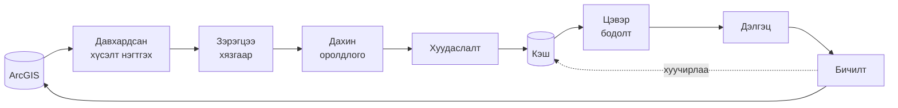
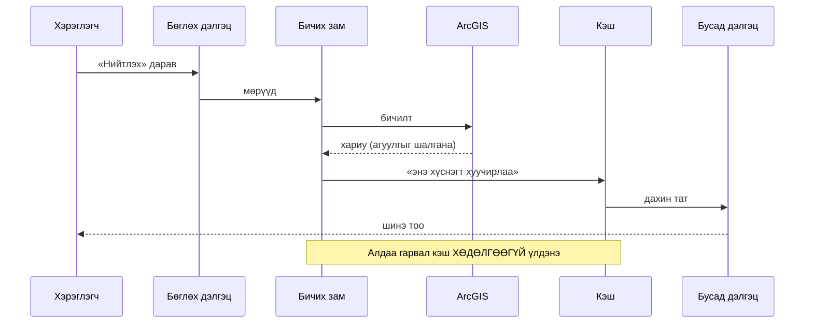

# 03 · Тоо дэлгэц дээр хэрхэн гарч ирдэг вэ

Энэ файл нь «энэ тоо хаанаас гарав?» гэсэн асуултын **механизмыг** тайлбарлана.
Эх сурвалж өөрөө [02](02-ogogdliin-esurvalj.md)-т.

---

## 1. Дөрвөн үе шат



Энэ бол баримтын **гол зураг**. Тоо бүр энэ замаар явна.

---

## 2. Асуулгын давхарга — юуг баталгаажуулдаг вэ

Порталын бүх уншилт нэг л замаар дамждаг
([`src/lib/query.ts`](../../src/lib/query.ts)).

### 2.1 Зэрэгцээ хүсэлтийн хязгаар

Систем нэгэн зэрэг **12** хүсэлт илгээж эхэлдэг. Хэрэв сервер «хэт олон
хүсэлт» гэж хариулвал хязгаар **6 болж буурч, буцаж өсөхгүй**.

⚠️ Яагаад буцаж өсгөдөггүй вэ: сервер нэг удаа гомдол хэлсэн бол дараагийн
хүнд ачаалал дээр дахин гомдоно. Тухайн сешнд аюулгүй түвшинд үлдэх нь
хэрэглэгчийн хувьд **бага зэрэг удаан** боловч **найдвартай**.

### 2.2 Дахин оролдлого

Хүсэлт унавал систем **4 удаа** дахин оролдоно, тус бүрийн хооронд хүлээх
хугацааг уртасгана. 30 секундэд хариу ирэхгүй бол цуцална.

### 2.3 Давхардсан хүсэлтийг нэгтгэх

Нэг дэлгэц дээр олон карт **ижил** асуулга явуулах нь түгээмэл. Систем
хоорондоо яг ижил хүсэлтийг нэг л удаа илгээж, хариуг бүгдэд тараана.

Хэмжсэн үр дүн: 41 ачаалагчийн **436 хүсэлтийн 44 нь яг ижил** байсан.

### 2.4 Хуудаслалт — 2,000-аас их мөрийг бүтнээр авах

ArcGIS нэг хүсэлтэд ойролцоогоор **2,000 мөр** буцаадаг. Түүнээс их бол
систем үлдсэнийг дараалан татна.

> ⚠️ Хэрэв эрэмбэ заагаагүй бол ArcGIS хуудас хооронд **тогтворгүй** дараалал
> буцааж, зарим мөр хоёр удаа, зарим нь огт ирэхгүй байж болно. Систем үүнийг
> илрүүлж, тогтвортой эрэмбээр эхнээс нь дахин татдаг.

### 2.5 ⚠️ ArcGIS алдааг «амжилттай» хариуны дотор буцаана

Энэ нь порталын хамгийн ноцтой занга. Систем хариу бүрийн **агуулгыг**
шалгадаг. Дэлгэрэнгүй: [06 §7](06-toonii-dursam.md).

---

## 3. Кэш ба хүчингүй болголт

### 3.1 Хүснэгтийн түлхүүр (16)

Кэш нь **ачаалагчаар биш, ХҮСНЭГТЭЭР** зохион байгуулагдсан
(`dataBus.ts`-ийн `DataKey`; тоог `docs.invariant.check.mjs` кодтой тулгана):

```
HO_IPC · CASHFLOW_NEW · BAGTS_SHEET · BAGTS_NEGTGEL · BUILDING
PARCEL_LEFT · SOURCE_FS · HABEA · HYANALT · ZOVSHOOROL
```

Урсгалын (ноорог · батлах) хүснэгтүүд — 2026-09-30-нд нэмэгдсэн; урьд нь автобусад
байгаагүй тул нооргийн бичилт цэсний тэмдгийг 3 мин хүртэл хуучин үлдээдэг байв:

| Түлхүүр | Хүснэгт | Юуг хүчингүй болгоно |
|---|---|---|
| `HUVAARI_BATLAH` | `Selbe_Huvaari_Batlah` | Хуваарийн илгээлт/батлалтын дараалал — `huvaariBatlah.ts` |
| `OBYEM_BATLAH` | `Selbe_Obyem_Batlah` | Обьёмын өөрчлөлтийн батлалт — `obyemBatlah.ts` |
| `AJIL_BATLAH` | `Selbe_Ajil_Batlah_csv` | Нэмэлт ажлын батлалт — `ajilBatlah.ts` |
| `HUVAARI_OBYEM` | `huvaari_20260906/193` | Хуваарийн сарын обьём — төлөвлөгөөт муруй (`planProgress`), 2026-10-01 |
| `TUSUL_NEGTGEL` | `Negtgel_guitsetgel_1013/199` | Нэгтгэл гүйцэтгэл (таб · дашбоард · тайлан) — табын «Засах · Нийтлэх»-ийн дараа (`negtgelEdit.ts`), 2026-10-15 |
| `MATERIAL_NOOTS` | `material_noots` (Enterprise) | Материалын нөөц (MA · «Материалын нөөц» · «Ажлын материал») — MA + MIR батлагдсан ачааг автоматаар бүртгэсний дараа (`materialNoots.syncNoots`), 2026-10-21 |

Ачаалагч бүр «би энэ хүснэгтээс уншина» гэж зарлана; бичих тал «би энэ
хүснэгтийг өөрчиллөө» гэж хэлнэ. Систем холбоосыг өөрөө олно.

⚠️ **Яагаад ачаалагчаар биш вэ:** «энэ ачаалагчийг шинэчил» гэж гараар
бичвэл шинэ ачаалагч нэмэгдэх бүрд тэр жагсаалт хоцорно. Хүснэгтээр
холбоход зураглал өөрөө тэнцвэрээ хадгална.

### 3.2 Бөглөснөөс дэлгэц хүртэл



⚠️ Хүчингүй болголт нь бичилт **амжилттай болсны дараа л** ажиллана.
Амжилтгүй бичилтийн дараа кэш хаявал сайн өгөгдлийг дэмий дахин татна.

### 3.3 Алдааг кэшлэхгүй

Хүсэлт унавал систем тэр үр дүнг **хадгалахгүй** — дараагийн оролдлого
шинээр явна. Эс бөгөөс нэг удаагийн сүлжээний тасалдал сешн дуустал
«өгөгдөл байхгүй» болж үлдэнэ.

### 3.4 Кэш асуулгын давхаргад БАЙХГҮЙ

Давхардсан хүсэлтийг нэгтгэх (§2.3) нь **кэш биш** — хариу ирмэгц
устдаг. Тиймээс хуучирсан өгөгдөл хэзээ ч буцаахгүй.

### 3.5 Хуучрах хугацаа (TTL) — хоёрхон утга (2026-10-12)

Түлхүүр (§3.1) нь **өөрийн** бичилтийг шууд тусгана; **өөр хэрэглэгчийн** бичилтийг
зөвхөн TTL барина. Ачаалагч бүрд тусдаа тоо байхгүй — хоёрхон анги:

| Анги | TTL | Ачаалагчид | Яагаад |
|---|---|---|---|
| Санхүүгийн «амьд» | **60 с** | `Finance.loadFinData` · `loadCashflowNewRows` · `loadCfMonthRows` · `loadFinRegister` (`LIVE_TTL`), `ipc.loadHoRows` (`HO_TTL`), `ceo/ipc.loadIpcKpi` (`IPC_TTL`), `ceo/contractGap.loadContractGapKpi`, `ceo/uncontracted.loadUncontractedKpi` | `HO_IPC` / `CASHFLOW_NEW`-ийг өдөрт олон хүн засдаг — хоёр хүн зөрсөн тоо хараад маргах хугацаа 5 мин байж болохгүй (`Finance.tsx`-ийн 2026-08-28-ны ⚠️). Богиносговол 257 талбартай хүснэгт минутанд олон удаа татагдана. |
| Сешний | **5 мин** (`live.SESSION_TTL_MS`) | бусад БҮХ `cached()` ачаалагч: `live` · `reportData` · `execReport` · `gdash` · `land` · `negtgel` · `blockProgress` · `ceo/schedule` · `ceo/variance` · `execTriage` (обьёмын зөрүү · давхцал · хохирол) … | Хуучрал нэг жигд (`live.ts`-ийн 2026-10-05-ны ⚠️); TTL нь дараагийн дуудалтад л шалгагдах тул нээлттэй дэлгэцийг `Portal`-ын «Шинэчлэх» ба таб буцах үеийн `invalidateAll` шинэчилнэ (§5). |

⚠️ 2026-10-12 (дарааллын аудит): `ceo/schedule` · `ceo/variance` 60 с байсныг 5 мин болгов —
санхүүгийн биш. `execTriage`-ийн гурван гар кэш TTL-гүй байсныг `cached` болгов. Хуваарийн
карт нь `loadFinData` (60 с)-аас уншдаг тул түүнээс хамгийн ихдээ 5 мин хоцорч болно — хүлээн
зөвшөөрсөн. 60 с-ийн тоог `dataBus.ts`-д БИШ, энд л баримтжуулна.

---

## 4. Бодолтын давхарга

### 4.1 Яагаад тусгаарлагдсан вэ

Бүх тооцоо нь **сүлжээнд хандахгүй, цэвэр** функцээр бичигдсэн. Ингэснээр
тэдгээрийг амьд үйлчилгээгүйгээр, тогтмол өгөгдлөөр шалгах боломжтой.

Төсөлд ийм шалгуур **180 гаруй** (`*.check.mjs`, 2026-10-09-нд 189) байна — тоон логикийн алдааг нийтлэхээс өмнө барина.

### 4.2 Юу тооцдог вэ

| Бодолт | Юуг гаргадаг |
|---|---|
| Ерөнхий дашбоардын тооцоо | Санхүү · газар · төлөвлөгөө · ХАБЭА-г нэг хугацааны шүүлтээр нэгтгэнэ |
| Хуваарийн загвар | Ажлын үргэлжлэх хугацаа, хоцрогдол, хуваарийн хамралт |
| Санхүүжилтийн тооцоо | Гэрээгээр бүлэглэх, багцад хуваарилах, дугаарын цоорхой олох |
| Төлбөр-багцын холбоос | Аль төлбөр аль багцад хамаарахыг обьёмын агшнаар тогтооно |
| Нэгтгэлийн тооцоо | Багцын жинлэсэн гүйцэтгэлийг төслийн түвшинд хүргэх |
| Төлөвлөгөөт муруй | Гэрээний сарын дүнгээс хуримтлал өөрөө бодно ([06 §4](06-toonii-dursam.md)) |
| Блокийн явц | Бөглөх хуудсаас барилгын блок тус бүрийн түүх |
| Үерийн загвар | Гадаргуугийн өндрөөс усны хөдөлгөөн |
| Удирдлагын үзүүлэлт | 13 KPI (доор) |

### 4.3 Удирдлагын 13 үзүүлэлт

Дараалал нь **төслийн мөчлөгөөр**: судалгаа → зөвшөөрөл → газар → хуваарь →
гүйцэтгэл → чанар → ашиглалт → хүн → аюулгүй байдал → хяналт → санхүү.

| # | Үзүүлэлт | Юу хэмждэг | Эх сурвалж | Очих дэлгэц |
|---|---|---|---|---|
| 1 | Тохиромжтой байдал | Бүсийн хөгжлийн боломжийн үнэлгээ | Орон зайн шинжилгээ | Анализ |
| 2 | Зөвшөөрөл | Хүлээгдэж буй хүсэлт | `ZOVSHOOROL` | Зөвшөөрөл |
| 3 | Газар чөлөөлөлт | Чөлөөлөгдөөгүй үлдсэн талбар | `PARCEL_LEFT` | Газар |
| 4 | Хуваарийн хоцрогдол | Төлөвлөгөө ↔ бодит хугацаа | `BAGTS_SHEET` · `CASHFLOW_NEW` · `HO_IPC` | Багцын гүйцэтгэл |
| 5 | Обьёмын зөрүү | Төлөвлөсөн ↔ гүйцэтгэсэн обьём | `BAGTS_SHEET` | Гүйцэтгэл |
| 6 | Мэдрэгчийн босго | Хэмжилт хэвийн хязгаараас гарсан эсэх | `IOT` | IoT |
| 7 | Хүн · техник | Өмнөх өдрөөс хэлбэлзэл | `HABEA` | ХАБЭА |
| 8 | ХАБЭА | Осол, зөрчлийн тоо | `HABEA` | ХАБЭА |
| 9 | Хяналтын хоцролт | Бөглөснөөс шийдвэрлэх хүртэлх хугацаа | `HYANALT` · `BAGTS_SHEET` | Гүйцэтгэл |
| 10 | Гэрээ ба төсвийн зөрүү | Төсөвлөсөн ↔ гэрээлсэн | `CASHFLOW_NEW` | Санхүү |
| 11 | Гэрээгүй ажил | Төсөвлөсөн ч гүйцэтгэгч шалгараагүй | `CASHFLOW_NEW` | Санхүү |
| 12 | Олгосон санхүүжилт | Бодитоор шилжсэн мөнгө | `HO_IPC` | Санхүү |

⚠️ №12 нь **«акт» БИШ**. Эх сурвалж нь бүртгэгдсэн төлбөр бөгөөд актын
төлөв, хамрах хугацаа, суутгал агуулдаггүй.

⚠️ Хүнд тооцоолол шаардсан үзүүлэлтүүд (1 · 3 · 5 · 6) хөнгөнийхөө дараа
шатлан ачаалагдана — бүгд зэрэг явбал сервер «хэт олон хүсэлт» гэж хариулна.

---

## 5. Тоо ХЭЗЭЭ шинэчлэгддэг вэ

**Асуулт:** «Би одоо бөглөлөө. Дашбоард дээр хэзээ гарах вэ?»

**Хариу:** бичилт амжилттай болмогц, тэр хүснэгтээс уншдаг **бүх дэлгэц
шууд** шинэчлэгдэнэ. Хуудсыг дахин ачаалах шаардлагагүй.

> ⚠️ **Гэхдээ зөвхөн ТАНЫ дэлгэц дээр.** Өөр хэрэглэгчийн нээлттэй байгаа
> хуудас өөрөө шинэчлэгдэхгүй — тэр хүн хуудсаа дахин ачаалах эсвэл өөр
> харагдац руу орж буцах хэрэгтэй.
>
> Хурал дээр хоёр хүн ижил дэлгэц хараад өөр тоо харах шалтгаан ихэвчлэн энэ.
> Дэлгэрэнгүй: [08 §4](08-hyzgaarlalt.md).

Зарим ачаалагч **5 минутын** шинэчлэлтийн хугацаатай — өөр хүний оруулсан
өгөгдөл тэр хугацаанд өөрөө орж ирнэ.

## Enterprise — бүх өгөгдлийн ганц эх (2026-10-20)

2026-10-20-оос портал БҮХ өгөгдлөө Сэлбэ Enterprise (`gis.selbecity.mn`, env `NEXT_PUBLIC_ENT_DATA` =
`…/map/rest/services/Hosted`)-ээс уншина: 225 давхарга/хүснэгт, BIM, меш, ортофото, IoT, ХАБЭА, замын тайл.
ArcGIS Online (AGOL) ба UBHUB бүрмөсөн хасагдсан — тэдгээр хост руу хүсэлт явахгүй.

**Хаягийн зураглал.** Кодын ~90 давхарга AGOL-ын хуучин хаягаар (`${HJ}/<үйлчилгээ>/FeatureServer/<№>`,
`src/lib/services/agolKey.ts` — сүлжээний хаяг БИШ, ТҮЛХҮҮР) бичигдсэн хэвээр; `src/lib/services/entMap.data.ts`
(`tools/entMap-build.mjs` үүсгэнэ — экспортын тайлан + Enterprise мета + `tools/agol-fields.py`) нь
`<AGOL үйлчилгээ>/<№>` → `<Enterprise үйлчилгээ>/<№>` зураглал. `entMap.remapUrl` нь REST-ийн ганц цөм (`query.run`),
газрын зургийн давхарга (`layerUrl`) ба порталын хайлтаар олддог байсан хүснэгтүүдэд (`entDirect`: эрх · ноорог · батлах)
хэрэглэгдэнэ. Зураглалгүй AGOL хаяг → ил алдаа (чимээгүй AGOL руу буцах зам байхгүй).

**Талбарын нэр.** Enterprise (PostgreSQL) нийтлэхдээ талбарын нэрийг ЖИЖИГ үсэг болгосон (`BAGTS` → `bagts`);
геометрийн системийн талбар `SHAPE__Area` / `SHAPE__Length`. Код эх нэрээрээ ханддаг тул `entMap.ts` хүсэлтийн
`outFields` · `orderByFields` · `applyEdits`-ийг Enterprise нэр рүү, хариуг эх нэр рүү (дуудагчийн `outFields`-ийн үсэг →
`ENT_FIELDS` толь) хөрвүүлнэ — REST-д `query.attemptRequest`, JS API-ийн давхаргад `lib/entInterceptor.ts`
(`esriConfig.request.interceptors`; мета дээр PBF-ийг хааж JSON-оор асуулгана). OID (`FID`/`OBJECTID` → `objectid`) ба
засварын мөшгөлт (`EditDate` → `last_edited_date`) мөн зураглагдана.

**Нэвтрэлт.** Enterprise геопортал (`NEXT_PUBLIC_PORTAL_URL` = `…/geoportal`, OAuth апп `NEXT_PUBLIC_AUTH_APP_ID`,
`NEXT_PUBLIC_ALLOWED_ORG_ID` = порталын id). Ижил токен өгөгдөл, ХАБЭА-ийн бичилт, PDF баримтад (`entDocs.entSession`).

---

**Дараагийн алхам:** харагдац бүр юу харуулдгийг
[04 · 25 харагдац](04-haragdac.md)-аас үзнэ үү.

---

**Хамгийн сүүлд шинэчилсэн:** 2026-10-20
**Автомат шалгуур:** [`docs/docs.invariant.check.mjs`](../docs.invariant.check.mjs) (Ш2, Ш4, Ш5)
**Гараар шалгах:** зэрэгцээ хязгаарын тоо (12 · 6), дахин оролдлогын тоо (4)
