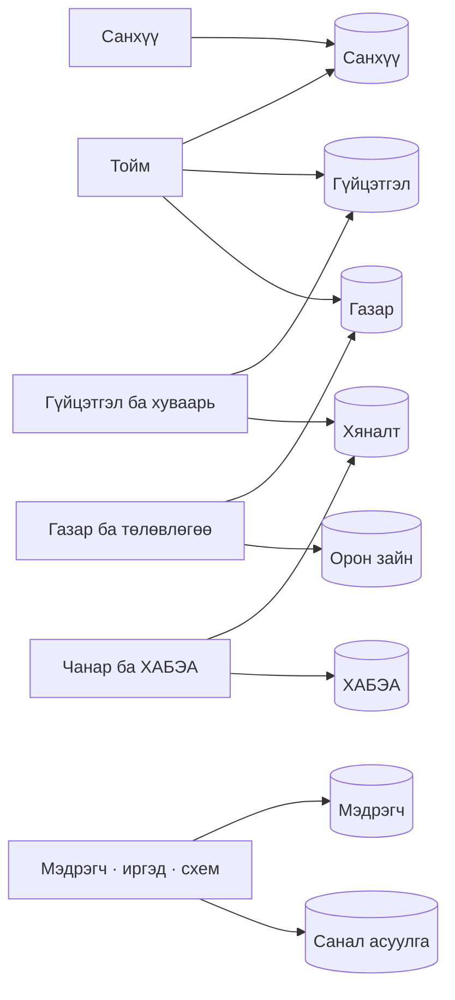

# 04 · Харагдацууд

Портал **27 харагдацтай**. Энэ файл нь тус бүр нь юунд хариулдаг, тоо нь
хаанаас гардгийг тайлбарлана.

---

## 0. Харагдац ↔ эх сурвалжийн холбоо

⚠️ Харагдацуудыг 11 эх сурвалжтай бүрэн холбовол зураг уншигдахгүй болно.
Тиймээс харагдацуудыг **сэдвээр бүлэглэв**.

| Бүлэг | Харагдацууд |
|---|---|
| Тойм | Ерөнхий дашбоард · Төслийн дэлгэрэнгүй · Тайлан · Үйл ажиллагааны схем |
| Санхүү | Багцын санхүү · Санхүүжилт |
| Гүйцэтгэл ба хуваарь | Багцын гүйцэтгэл · Гүйцэтгэл · Хуваарь |
| Газар ба төлөвлөгөө | Газар чөлөөлөлт · Ерөнхий төлөвлөгөө · Хэсэгчилсэн ЕТ · Инженерийн дэд бүтэц · Зөвшөөрөл · Тохиромжтой байдал |
| Чанар ба ХАБЭА | Чанар · ХАБЭА |
| Бусад | IoT хяналт · Эрсдэлийн загвар · Иргэдэд хүрэх үр өгөөж |

---

## 1. Бүгд нэг хүснэгтэд

⚠️ **«Бөглөдөг үү» багана чухал.** Тоо нь хүний гараар оруулсан уу, эсвэл
системийн тооцоолсон уу — хоёрын итгэх түвшин өөр.

| Харагдац | Юунд хариулдаг вэ | Гол эх сурвалж | Тоо яаж гардаг вэ | Бөглөдөг үү |
|---|---|---|---|---|
| **Ерөнхий дашбоард** | Төсөл ямар байдалтай вэ? | `HO_IPC` · `PARCEL_LEFT` · `BAGTS_NEGTGEL` · `HABEA` | 4 салбарын үзүүлэлтийг нэг хугацааны шүүлтээр нэгтгэнэ | Үгүй |
| **Төслийн дэлгэрэнгүй мэдээлэл** | Дэлгэрэнгүй судлах | олон эх сурвалж | 9 дэд хэсэгт задарна | Үгүй |
| **Ерөнхий төлөвлөгөө** | Юу хаана баригдах вэ? | `TD` (хуучин `ET` · `ET_PKG`-ийн хуулбар) | Давхарга бүрийн тоо, урт, талбайг шууд тоолно | Үгүй |
| **Хэсэгчилсэн ЕТ** | Шинэчлэгдсэн төлөвлөгөө юугаараа өөрчлөгдсөн, дэд бүтэцтэй хаана давхцаж байна, юу нэмж татах вэ? | `Redesign` (`rd:*`) · `TD` (`sb:*`) · инженерийн дэд бүтэц (`…_0916`) | Хөтөч дээр: геодезийн урт/талбай, Intersect, хамгийн ойр холболт | Үгүй |
| **Багцын санхүү** | Аль багц хэдий мөнгө авав? | `HO_IPC` + `CASHFLOW_NEW` | Багцаар нийлүүлж, төлөвлөгөөтэй харьцуулна | Үгүй |
| **Багцын гүйцэтгэл** | Аль багц хэдэн хувьтай вэ? | `BAGTS_SHEET` · `BAGTS_NEGTGEL` | Бөглөх хуудасны жинлэсэн хувийг ШУУД авна | Шууд бус |
| **Газар чөлөөлөлт** | Газар хэр чөлөөлөгдсөн бэ? | `PARCEL_LEFT` · `BUILDING` | Үлдсэн талбарын тоо, талбайг төлөвөөр бүлэглэнэ | **Тийм** |
| **Тохиромжтой байдлын үнэлгээ** | Хаана юу барих нь зөв бэ? | орон зайн давхаргууд | БНБД норм + эдийн засгийн оноо | Үгүй |
| **Иргэдэд хүрэх үр өгөөж** | Иргэдэд юу нэмэгдэв? | `IRGED_BUILT` · `IRGED_TOILET` · нийгмийн давхаргууд | Өмнө ↔ дараа харьцуулалт | Үгүй |
| **Хуваарь** | Ажил хэзээ эхэлж дуусах вэ? | `BAGTS_SHEET` · `HUVAARI_OBYEM` | Блокийн хэмнэлээс хугацаа бодно | **Тийм** |
| **Хуваарь батлах** | Ямар хуваарийн санал хүлээгдэж байна? | хуваарийн батлах хүснэгт | Бүх багцын ирсэн саналыг НЭГ дараалалд · зохиогч өөрийгөө батлахгүй · түгжээ төрлөөр (гэрээ / төлөвлөгөө) · хагас бичигдсэнийг «Гацсаныг буцаах» ([05 §6.1](05-erh-batlah.md)) | **Тийм** |
| **Нэмэлт ажил батлах** | Гэрээнд ямар шинэ ажил нэмэх санал ирсэн бэ? | нэмэлт ажлын батлах хүснэгт | Бүх багцын саналыг НЭГ дараалалд · батлагдсан мөр «Гүйцэтгэл бөглөх» нээгдэхэд тэнд буудаг · зохиогч өөрийгөө батлахгүй | **Тийм** |
| **Тайлан** | Тайлан бэлтгэх | бүх гол эх сурвалж | Бэлэн загварт тоог байрлуулна | Үгүй |
| **ТУХ** | Багц бүр улсын комисс, IPC, хуваарийн хувьд хаана явна вэ? | `CASHFLOW_NEW` · `HO_IPC` · `BAGTS_SHEET` · `HABEA` · чанарын баримт | Байгаа ачаалагчдын тоог багцаар холбоно; «Улсын комисс»-ын огноо «Хуваарь»-аас; эх сурвалжгүй хэсэг «—» | Шууд бус |
| **Багцын хамаарал** | Аль багц аль багцаас хамаардаг вэ? | `CASHFLOW_NEW` (багцын жагсаалт) · ноорог хүснэгтийн `bagtsHamaaral` мөр (холбоосууд) | ТУХ-ын багцуудыг хооронд нь схем ба жагсаалтаар холбоно; багц доторх ажлын уялдаанд хамаагүй | **Тийм** (зөвхөн холбоо, `hamaaral` эрх) |
| **ТЭЗҮ · Ажлын зураг төсөл** | ТЭЗҮ ба зураг төслийн ажил хэр явж байна? | `CASHFLOW_NEW` (ТЭЗҮ / Ажлын зураг төсөл үе шатын навч мөр) | Навч мөрийн эхлэх/дуусах огноо ба явцын хувийг (0–100) шинэчилнэ; багцад дэд шат нэмнэ | **Тийм** (`zuragEdit` эрх) |
| **6 түвшний хуваарь** | Төсөл мастер хуваариас өдрийн ажил хүртэл хэр явж байна? | `CASHFLOW_NEW` (Excel шиг мод, `dd_kod`) · бөглөх хуудас · Хуваарь | L1 мастер · L2 үе шат · L3 хяналт · L4 сарын · L5 7 хоног · L6 өдөр; хувь нь `projectPlan`-ийн томьёогоор | Үгүй |
| **Санхүүжилт** | Гэрээ хэрхэн санхүүжиж байна? | `CASHFLOW_NEW` · `HO_IPC` | Гэрээгээр бүлэглэж, сараар задална | **Тийм** |
| **ХАБЭА** | Аюулгүй байдал ямар вэ? | `HABEA` (3 маягт) | Осол, хүн-техникийг өдрөөр тоолно | Survey123-аар |
| **IoT хяналт** | Мэдрэгч юу хэлж байна? | `IOT` (5 үйлчилгээ) | Хугацааны цуваа + сүүлийн заалт | Үгүй |
| **Эрсдэлийн загвар** | Үер, бохирдлын эрсдэл? | гадаргуугийн өгөгдөл | Загварчлалын тооцоо | Үгүй |
| **Инженерийн дэд бүтэц** | Шугам сүлжээ хэр баригдав? | `INFRA_SVC` · `TD` | Давхаргын тоо, урт нийлбэр | **Тийм** |
| **Зөвшөөрөл** | Ямар зөвшөөрөл хүлээгдэж байна? | `ZOVSHOOROL` | Төлөвөөр бүлэглэн тоолно | **Тийм** |
| **Гүйцэтгэл** | Бөглөх · илгээх · батлах | `BAGTS_SHEET` · `HYANALT` | 7 шатат урсгалын төлөв | **Тийм** |
| **Материал баталгаажуулалт** | Материал батлагдсан уу, аль ажилд хамаарах вэ? | MA Survey123 (Enterprise hosted, `NEXT_PUBLIC_CHANAR_MA_SVC`) | Нэг хариу бичгийн сүүлийн илгээлт хүчинтэй; шийдвэр A/AN/R-ээр тоолно | **Тийм** (зөвхөн хавсралт, Enterprise нэвтрэлт) |
| **Үйл ажиллагааны схем** | Төсөл ямар шатанд явна вэ? | 8 эх сурвалж | Байгаа тоог схемийн картад байрлуулна | Үгүй |
| **Системийн баримт** | Портал өөрөө яаж ажилладаг вэ? | — (энэ баримт) | Тоо байхгүй — зөвхөн тайлбар | Үгүй |

⚠️ «Шууд бус» гэдэг нь: тэр дэлгэцээс өөрөөс нь бөглөхгүй ч, харуулж буй тоо нь
хүний бөглөсөн өгөгдлөөс гардаг гэсэн үг.

---

## 2. Зургаан гол харагдац дэлгэрэнгүй

### 2.1 Ерөнхий дашбоард {#gdash}

**Ямар асуултад хариулдаг вэ.** Төсөл бүхэлдээ ямар байдалтай байна вэ?
Нэг дэлгэцээс санхүү, газар, төлөвлөгөө, аюулгүй байдлын байдлыг харна.
Портал нээхэд эхэлж гарч ирдэг.

**Дэлгэц дээр юу харагддаг вэ.** Дээд талд гол үзүүлэлтүүд, доор нь
санхүүгийн муруй, газар чөлөөлөлтийн явц, багцын гүйцэтгэлийн жагсаалт,
ХАБЭА-гийн товч.

**Тоо хаанаас гардаг вэ**

| Үзүүлэлт | Эх сурвалж | Тооцох арга |
|---|---|---|
| Төслийн төсөв | `CASHFLOW_NEW` | Гэрээний ажлын мөрүүдийн нийлбэр |
| Олгосон санхүүжилт | `HO_IPC` | Бүх төлбөрийн бичилтийн нийлбэр |
| Газар чөлөөлөлт | `PARCEL_LEFT` | Үлдсэн талбарын **багасалт** |
| Гүйцэтгэлийн хувь | `BAGTS_NEGTGEL` | Багцын жинлэсэн дундаж |
| ХАБЭА | `HABEA` | Ослын тоо, хүн-техникийн өдрийн задаргаа |

⚠️ **Анхаарах зүйл**
- Хугацааны шүүлт **бүх картад нэгэн зэрэг** үйлчилнэ — нэг картын тоо
  өөрчлөгдвөл бусад нь ч өөрчлөгдсөн байна.
- Гүйцэтгэлийн хувь нь **батлагдсан** нэгтгэлээс гардаг. Өнөөдөр бөглөсөн ч
  батлагдаагүй өгөгдөл энд харагдахгүй — [05 §6](05-erh-batlah.md).
- Хэмжигдээгүй ажил тооцоонд **ОРОХГҮЙ** — [06 §2](06-toonii-dursam.md).

**Хэн засаж чадах вэ.** Энэ дэлгэцээс юу ч засахгүй — зөвхөн харах.

**Холбоотой:** [02 §3](02-ogogdliin-esurvalj.md) · [06 §2](06-toonii-dursam.md)

---

### 2.2 Багцын санхүү {#pkgfin}

**Ямар асуултад хариулдаг вэ.** Аль багц хэдий мөнгө төлөвлөсөн, хэдийг
бодитоор авсан бэ? Хоёрын зөрүү хэр вэ?

**Дэлгэц дээр юу харагддаг вэ.** Багцын жагсаалт, тус бүрд гэрээт дүн,
олгосон дүн, хувь. Багц дарахад төлбөрийн бичилтүүд задарна.

**Тоо хаанаас гардаг вэ**

| Үзүүлэлт | Эх сурвалж | Тооцох арга |
|---|---|---|
| Олгосон санхүүжилт | `HO_IPC` | Багцын бүх төлбөрийн нийлбэр |
| Гэрээт дүн | `CASHFLOW_NEW` | Багцын гэрээнүүдийн төсөв |
| Гүйцэтгэлийн хувь | дээрх хоёр | олгосон ÷ гэрээт × 100 |
| Хэмнэлт | `CASHFLOW_NEW` | **Тусгай талбараас, ТООЦООЛДОГГҮЙ** |
| Урьдчилгаа / гүйцэтгэл | `HO_IPC` | Төлбөрийн төрлөөр салгана |

⚠️ **Анхаарах зүйл**
- «Хэмнэлт» нь эх сурвалжаас **шууд ирдэг**, портал бодохгүй. Эргэлзвэл
  анхдагч бүртгэлээс шалгана.
- Гэрээний талбар төлбөрийн мөр бүрд **давтагдана** — Excel-ээр нийлбэр
  авбал төсөв хэд дахин гарна ([02 §3.1](02-ogogdliin-esurvalj.md)).
- Зарим төлбөр багцад **холбогдоогүй** байж болно; систем эдгээрийг тусад нь
  харуулдаг.

**Хэн засаж чадах вэ.** Харах зориулалттай. Төлбөр-багцын холбоосыг систем
өөрөө нөхдөг.

**Холбоотой:** [02 §3](02-ogogdliin-esurvalj.md) · [06 §6](06-toonii-dursam.md)

---

### 2.3 Багцын гүйцэтгэл {#pkgprog}

**Ямар асуултад хариулдаг вэ.** Аль багц хэдэн хувийн биет гүйцэтгэлтэй вэ?
Блок тус бүр ямар шатанд явна вэ?

**Дэлгэц дээр юу харагддаг вэ.** Багцын жагсаалт хувьтайгаа, блокийн
төлөвийн хүснэгт, барилгын хяналтын төлөв.

**Тоо хаанаас гардаг вэ**

| Үзүүлэлт | Эх сурвалж | Тооцох арга |
|---|---|---|
| Багцын гүйцэтгэл | `BAGTS_SHEET` | Бөглөх хуудасны жинлэсэн мөрийг **ШУУД** авна |
| Батлагдсан гүйцэтгэл | `BAGTS_NEGTGEL` | Долоон шат өнгөрсөн утга |
| Блокийн явц | `BAGTS_SHEET` | Блок бүрийн бөглөсөн мөрүүдийн түүх |
| Хяналтын төлөв | `HYANALT` | Аль шатанд хүлээгдэж байгаа |

> ⚠️ **Портал гүйцэтгэлийн хувийг ДАХИН БОДОХГҮЙ.** Бөглөх хуудсанд
> жинлэсэн хувь аль хэдийн тооцоологдсон байдаг. Портал түүнийг шууд харуулна.
> Тиймээс хувь буруу харагдвал **бөглөх хуудсаа** шалгана, порталыг биш.

⚠️ **Анхаарах зүйл**
- Газрын зураг дээр бөглөгдөөгүй блок **саарал** («мэдээлэлгүй») үлдэнэ,
  0%-иар будагдахгүй ([06 §2](06-toonii-dursam.md)).
- ⚠️ 2026-10-01 (хэрэглэгчийн шийдвэр): **Багц бүрийн хувь** (Дашбоардын «Багц
  ажлаар», Багцын мэдээлэл, Барилгын хяналт, Гүйцэтгэл, Тайлангийн §2 ба §3,
  удирдлагын тайлан) нь багцын **БҮХ блокийн дундаж** — гүйцэтгэл тайлагнаагүй
  блок **0%** гэж орно. Жишээ: 4 блоктой багцын зөвхөн нэг блок 100% тайлагнасан
  бол багц **25%** (100% биш). Блокийн жагсаалт нь **бөглөх хуудсуудын** блокууд
  (газрын зургийн давхарга биш). Огт тайлагнаагүй багц 0%. «—» нь зөвхөн бөглөх
  хуудас уншигдаагүй (ачаалалт унасан) үед. Тайлангүй блокийн тоо тоотой хамт
  харагдана. 2026-09-30-ны «зөвхөн тайлагнасан блокуудын дундаж» дүрэм хүчингүй.
- ⚠️ 2026-09-30: **Орон сууцны нийт биет гүйцэтгэл** (энэ дэлгэцийн «Бодит»,
  Дашбоард, Ерөнхий дашбоардын «ОРОН СУУЦНЫ ХОРООЛОЛ», Тайлан, удирдлагын
  тайлан) нь НЭГ томьёо: багц бүрийн хувийг **ХО дүнгээр** жигнэнэ
  (Σ ХО × хувь ÷ Σ ХО), блокийн тоогоор биш. ⚠️ 2026-10-01-ээс огт
  тайлагнаагүй багц ч **0%**-иар орно (урьд нь хасагддаг байв). Тайлангийн
  эхний өгүүлбэрийн «төслийн хэрэгжилт» нь харин «Нэгтгэл гүйцэтгэл»-ийн
  төслийн нийт хувь (Ерөнхий дашбоардын «Гүйцэтгэлийн хувь») — орон сууцны
  хувь биш. Тайлан §2 ба §3-ын «Нийт» нэг тоо.

**Хэн засаж чадах вэ.** Энэ дэлгэцээс биш; бөглөлт нь «Гүйцэтгэл» дэлгэцээр.

**Холбоотой:** [06 §1–2](06-toonii-dursam.md) · [05 §5](05-erh-batlah.md)

---

### 2.4 Санхүүжилт {#finance}

**Ямар асуултад хариулдаг вэ.** Гэрээ хэрхэн санхүүжиж байна вэ? Сар бүр
хэдий мөнгө төлөгдөх төлөвлөгөөтэй вэ?

**Дэлгэц дээр юу харагддаг вэ.** Гэрээний хүснэгт (задардаг), төлөвлөгөөт ба
бодит муруй, сарын хуваарилалтын хүснэгт.

**Тоо хаанаас гардаг вэ**

| Үзүүлэлт | Эх сурвалж | Тооцох арга |
|---|---|---|
| Гэрээний төсөв | `CASHFLOW_NEW` | Ажлын мөрөөс шууд |
| Сарын хуваарилалт | `CASHFLOW_NEW` | Сарын мөрүүдээс |
| Төлөвлөгөөт муруй | `CASHFLOW_NEW` | Сарын дүнгээс хуримтлал **өөрөө бодно** |
| Бодит олголт | `HO_IPC` | Төлбөрийн бичилтийг сараар бүлэглэнэ |

> ⚠️ **Хуримтлагдсан хувь жил бүр тэглэгддэг.** Тиймээс систем эх сурвалжийн
> хуримтлалыг **ашиглахгүй**, гэрээний сарын дүнгээс өөрөө бодно. Эс бөгөөс
> төлөвлөгөөт муруй жил бүрийн 1-р сард 0 руу унана
> ([06 §4](06-toonii-dursam.md)).

⚠️ **Анхаарах зүйл**
- Зарим гэрээнд хугацааны талбар **хоосон** — эх файлд байгаагүй. 0 гэж
  ойлгож болохгүй.
- Excel загварын хүснэгт нь эх файлын бүтцийг давтдаг тул бүх мөрийг
  нийлүүлбэл эх файлд **байхгүй** тоо гарна.

**Хэн засаж чадах вэ.** Мөнгөн урсгалын төлөвлөгөөг тусгай эрхтэй хэрэглэгч
засна ([05 §2](05-erh-batlah.md)).

**Холбоотой:** [02 §3.2](02-ogogdliin-esurvalj.md) · [06 §4](06-toonii-dursam.md)

---

### 2.5 Гүйцэтгэл {#guitsetgel}

**Ямар асуултад хариулдаг вэ.** Бөглөсөн гүйцэтгэл ямар шатанд явна вэ?
Хэн дээр хүлээгдэж байна вэ?

**Дэлгэц дээр юу харагддаг вэ.** Бөглөх хуудас, илгээх товч, хяналтын
шатуудын төлөв, буцаасан тайлбар.

**Тоо хаанаас гардаг вэ**

| Үзүүлэлт | Эх сурвалж | Тооцох арга |
|---|---|---|
| Бөглөсөн обьём | `BAGTS_SHEET` | Хэрэглэгчийн оруулсан утга |
| Хяналтын шат | `HYANALT` | Хамгийн сүүлийн шийдвэрээс |
| Хоцролт | `HYANALT` | Илгээснээс шийдвэрлэх хүртэлх өдөр |

**Долоон шат:** компани → инженер → багцын ахлах инженер → төлөвлөлтийн
инженер → төлөвлөлтийн ахлах инженер → хэлтсийн дарга → газрын дарга →
шилжүүлсэн; буцаалт нэг шат ухарна.
Дэлгэрэнгүй: [05 §5](05-erh-batlah.md).

⚠️ **Анхаарах зүйл**
- Нэг удаад **мянга мянган мөр** нийтлэгдэж болно. Тасалдвал хагас орох
  эрсдэлтэй — [05 §7](05-erh-batlah.md), [08 §2](08-hyzgaarlalt.md).
- Батлагдаагүй гүйцэтгэл дашбоардын нэгтгэлд **ОРОХГҮЙ**.
- **Блокгүй багц (5.x · 6.x · 10) бөглөгддөг** (2026-10-09): бөглөх урсгал
  `fillSchema(pkg)`-ээр синтетик НЭГ блок авна — «Обьём (энэ удаа)» нэмэгдэл
  `obyem_sum`-д хуримтлагдаж `Ажил_гүйцэтгэл` = `obyem_sum ÷ Обьём` (Обьёмгүй/0
  мөр түгжээтэй), бүлэг Excel-ийн `SUMPRODUCT`-тэй ижил. Батлагдвал нэгтгэлд
  жинхэнэ хувь бичигдэнэ; юу ч хэмжигдээгүй бол бичихгүй
  ([bagts-guitsetgel-negtgel.md §6](../bagts-guitsetgel-negtgel.md)).
  Газрын зураг/дашбоард блокгүй хэвээр.
- **«Бусад талбар»** (2026-10-09): хүснэгтийн төгсгөлд үйлчилгээний урьд
  зурагддаггүй мөрийн талбарууд (дэс дугаар · хамаарал · шатлал · хүн хүч ·
  машин · гэрээ/бодит огноо · бөглөсөн огноо · хадгалсан L/M · архивын
  жааз бичсэн/засварласан огноо ба хэрэглэгч) **зөвхөн харах** баганаар —
  засах зам, тооцоо, бичилтэд ОРОХГҮЙ (`fill/extraCols.ts`). Тухайн
  үйлчилгээнд талбар байвал л гарна; хоосон утга хоосон нүд (0 биш).
  ⚠️ «Жааз …» баганууд нь архивын жаазны Editor Tracking — ажлыг хэн
  бөглөснийг БИШ. Блокгүй багцад хадгалсан L/M хасагдана (үндсэн нүдэнд
  аль хэдийн харагддаг). Анхдагч асаалттай; нуух товчны сонголт хэрэглэгч
  тус бүрд хөтөчид хадгалагдана.

**Хэн засаж чадах вэ.** Гүйцэтгэгч компанийн шатанд багцад томилогдсон
хэрэглэгч бөглөнө; шат бүрд тусдаа эрх ([05 §5](05-erh-batlah.md)). 2026-10-09-ний
дүрмүүд:

- **Хяналтад явж буй хуудас түгжээтэй.** Илгээсний дараа тэр хуудсыг 7 шат
  дуустал (`Шилжүүлсэн`) дахин бөглөж, илгээхгүй; буцаагдсан илгээлтийг засаж
  дахин илгээнэ. Хянагчийн харж буй одоогийн тойргоор бодно — UI ба домэйн нэг
  дүрэм (05 §5.1).
- **Батлагчид харах горим.** Батлагч бүр «Гүйцэтгэлийн хүснэгт» (зөвхөн харах)
  ба «Батлах ажил» табтай (05 §5.2).
- **Зөвшөөрсөн нүд түгжээтэй.** Буцаагдсан илгээлтэд хянагчийн ногоон ✓ нүдийг
  гүйцэтгэгч засахгүй — зөвхөн улаан хүрээтэйг (05 §5.3).
- **«Зөвхөн харна» томилгоо** — шийдвэр гаргахгүй; гүйцэтгэгчийн шатанд бөглөх,
  илгээх боломжгүй (05 §5.4).
- **Ноорог сэргэтэл хүснэгт хаалттай.** Ноорог бүрэн сэргэтэл хүснэгт нуугдаж
  идэвхгүй; 45 секундээс удвал зөвхөн дахин ачаалах товч гарна (05 §10.4).

**Холбоотой:** [05](05-erh-batlah.md) · [06 §2](06-toonii-dursam.md)

---

### 2.6 Үйл ажиллагааны схем {#schem}

> ⚠️ **ЭНЭ БАРИМТТАЙ АНДУУРЧ БОЛОХГҮЙ.**
>
> Порталын «Үйл ажиллагааны схем» нь **барилгын төслийн** ажлын урсгалыг
> зурдаг: Төлөвлөлт → Зөвшөөрөл / Газар → Хуваарь → Барилга → Хяналт →
> Санхүү → Тайлан.
>
> Харин та одоо уншиж буй баримт нь **програм хэрхэн ажилладгийг**
> тайлбарлана. Хоёр өөр зүйл.

**Ямар асуултад хариулдаг вэ.** Төсөл ямар шатанд явна вэ? Аль үе шатанд
хэдэн ажил хүлээгдэж байна вэ?

**Дэлгэц дээр юу харагддаг вэ.** Хоорондоо сумаар холбогдсон карт бүхий
схем. Хоёр нарийвчлал: **ерөнхий** (10 карт) ба **дэлгэрэнгүй** (24 карт).
Карт дарахад дэлгэрэнгүй самбар нээгдэнэ.

**Тоо хаанаас гардаг вэ.** Энэ харагдац **шинэ асуулга явуулдаггүй** — бусад
дэлгэц аль хэдийн татсан тоог дахин ашиглана. Тиймээс дашбоардаас схем рүү
орход нэмэлт хүлээлт гарахгүй.

Найман эх сурвалж: `CASHFLOW_NEW` · `PARCEL_LEFT` · `BAGTS_SHEET` ·
`BAGTS_NEGTGEL` · `HABEA` · `HO_IPC` · `HYANALT` · `ZOVSHOOROL`.

⚠️ **Анхаарах зүйл**
- Сумны гурван төрөл: **үе шатны хамаарал** · **тэжээх холбоо** (дараалал биш) ·
  **буцаалт**. Бүгдийг нэг сумаар зурвал худал ойлголт төрнө.
- Аль нэг эх сурвалж унавал схем түүнийг **нэрлэж** харуулна — «өгөгдөл алга»
  гэж чимээгүй хоосон болохгүй.

**Хэн засаж чадах вэ.** Харах зориулалттай.

**Холбоотой:** [03 §3](03-ogogdliin-zam.md)

---

## 3. Үлдсэн харагдацууд

### Төслийн дэлгэрэнгүй мэдээлэл
Газрын зургийг тойрсон нэгдсэн үзүүлэлт, 9 дэд хэсэгт задардаг судлах хэрэгсэл.
⚠️ «Ерөнхий дашбоард»-тай **хоёулаа** байдаг: энэ нь задардаг, тэр нь задрахгүй
тойм ([08 §5](08-hyzgaarlalt.md)).

### Ерөнхий төлөвлөгөө
Бүс, барилга, инженерийн шугам, зам, ногоон орчны байршил.
Тоо нь давхаргын шууд тоолол — тооцоолол байхгүй.

### Хэсэгчилсэн ЕТ
Гурван хэсэг: **01** шинэчлэгдсэн төлөвлөгөөний тоо хэмжээ ба өмнөх ЕТ-өөс нэмэгдсэн нь
(бүс — тоо/талбай, бүх төрлийн зам — тооцоолсон тэнхлэгийн урт, ногоон — талбай);
**02** инженерийн объект × төлөвлөлтийн бодит геометрийн давхцал;
**03** шинэ барилгыг ижил төрлийн сүлжээнд автозам, явган замын коридороор холбох урьдчилсан трасс.
Анхны зураг нь хэсэгчилсэн ЕТ. Fullscreen-ийн доорх Swipe товчоор харьцуулна:
01 — хуучин / хэсэгчилсэн ЕТ; 02 — хэсэгчилсэн ЕТ / зөвхөн идэвхжүүлсэн давхцал;
03 — 18-р хэсгийн инженерийн эх давхаргууд / хэсэгчилсэн ЕТ-д нэмэгдэх холболт.
01-д сонголтгүй үед Swipe-ийн зүүн талд хуучин ЕТ бүстэйгээ харагдана. Ангилал сонгоход
хоёр талд зөвхөн харгалзах давхаргууд үлдэж, сонголтыг цуцлахад хуучин бүс дахин асна.
Энгийн зураг хэсэгчилсэн ЕТ хэвээр. Сэлбэ 1 хил хоёр талд тод хүрээгээр харагдана.
Ногоон байгууламжийг хуучин ЕТ-ийн бүтэн `sb:1` талбайгаас авч шинэ төлөвлөгөөний ногоон талбайтай харьцуулна.
Автозам, ногоон байгууламжийн карт ба хүснэгтэд хуучин/шинэ хэмжээ харагдах бөгөөд «Өөрчлөлт» статистикийг харуулахгүй.
Ангилал болон давхаргын сонголт зураг дээр бусдыг нууж, давхаргын мөр нь тухайн огтлолцол руу ойртуулна.
01-ийн замын бүтэн полигоноос тэнхлэг гаргасны дараа хамрах хүрээ, бүсээр тайрч уртыг хэмжинэ;
полигон тайрснаас үүсэх шинэ ирмэгийг замын уртад тооцохгүй. Автозамыг хоёр талд «Сэлбэ 1 хил»-ээр
харьцуулна. Бүсийн харьцуулалт хуучин болон шинэ төлөвлөгөөний бүх бүсийг хамарна.
Талбай, эх давхарга ба объектын тоо нь эх полигоноос; тэнхлэгийн урт нь растер нарийвчлалтай
тооцоо тул нарийвчлал болон гүйцэд бодогдоогүй хэсгийг самбарт мэдээлнэ.
Тэнхлэг нь зөвхөн статистикт хэрэглэгдэнэ: хуучин, шинэ урт, нэмэгдсэн/буурсан хэмжээ,
хувийг картуудаар харуулна. Зураг дээр эх давхаргын полигон, загвараар харьцуулж,
ангилал/бүсийн шүүлтийг эх давхаргад хэрэглэнэ; тооцоолсон тэнхлэгийг зурахгүй.
Хоёр талын хэмжилт байгаа бол тэнхлэг хэсэгчилсэн үед ч шинэ − хуучин зөрүүг карт болон
«Өөрчлөлт» баганад харуулж, хэсэгчилсэн хэмжилтийн зөрүү гэж тэмдэглэнэ. Татагдаагүй эх
өгөгдөл, тэнхлэг огт гаргаагүй хэсгийг 0 гэж орлуулахгүй; бодитоор хоосон хүрээний 0 утга хүчинтэй.
02-ын бүсийн эрэмбэ нь шинэ төлөвлөгөөний полигон бүрийг объектын дугаараар тусад нь гаргана.
Таван ангиллын давхцлыг эх инженерийн объект бүрээр нэгтгэж, давхар тоололгүй урт, объектын
тоогоор ихээс бага руу эрэмбэлнэ; давхцалгүй бүсийг 0-ээр харуулна. Сонголт нь ангилал,
давхарга, бүсийг хамтад нь шүүнэ. Шугамын өргөн масштаб дагаж нарийсна.
03-ийн төрөл ба бүсийн шүүлт хамт ажиллана. Гол тоо нь нэмэлт холболт шаардлагатай барилга:
эерэг урттай трасс болон шийдэгдээгүй хэрэгцээний барилгуудыг давхардалгүй тоолно;
одоо байгаа сүлжээнд хүрэлцсэн 0 м холболтыг хэрэгцээнд оруулахгүй. Төрөл, бүс бүрт
шаардлагатай барилгын тоо болон тэдгээрт үйлчлэх дундын хэсгийг нэг удаа тооцсон шинэ
шугамын бүтэн уртыг харуулна. Трасс тодорхойгүй хэсгийн тоог тусад нь мэдээлж, уртад 0 гэж
нэмж тайлагнахгүй. Бүс доторх физик урт, одоо байгаа + нэмэгдэх = нийт уртыг тусад нь үзүүлнэ.
Swipe-ийн зүүн талд инженерийн эх FeatureLayer-уудыг 18-р хэсгийн загвараар, төрөл/бүсийн
шүүлттэй харуулна. Анхнаасаа бүх шинэ шугам харагдана; уртын босго нь тусдаа
сонголтот шүүлт. Эх үүсвэргүй, коридор тасарсан, барилгын нэвтрэх замгүй холболтыг тодорхойгүй
гэж тэмдэглэнэ. Шугамын өнгө, хэв нь 18-р хэсгийн инженерийн давхаргуудтай нийцнэ.
⚠️ 03 нь 2D урьдчилсан трассын тооцоо: хүчин чадал, диаметр, даралт, бохир усны хэвгий,
газар ашиглах эрхийг баталгаажуулаагүй.
⚠️ Тооцоо нь хөтөч дээр явна — 02-ын үр дүн хөтчид 24 цаг хадгалагдана.

### Газар чөлөөлөлт
Полигон дотор шүүсэн чөлөөлөлтийн явц. Явцыг **үлдсэн** талбарын багасалтаар
хэмжинэ. ⚠️ Талбарын төлөв өөрчлөх эрх тусад нь олгогдоно.

### Тохиромжтой байдлын үнэлгээ
БНБД норм ба эдийн засгийн үр ашгаар бүс бүрийг үнэлнэ.
⚠️ Энэ нь **загварчлал**, бүртгэл биш — оноо нь таамаглал.

### Иргэдэд хүрэх үр өгөөж
Нийгмийн дэд бүтцийн өмнө ↔ дараа харьцуулалт.
⚠️ Санал асуулгын хариу ирээгүй хэсэг **хоосон** үлдэнэ — «сөрөг» гэж ойлгож
болохгүй.

### Хуваарь
Ажлын эхлэх, дуусах хугацааг блокийн хэмнэлээр төлөвлөнө.
⚠️ Хуваарь бол **хэмжилт биш төлөвлөгөө** — архивт шинэ агшин үүсгэхгүй,
байгаа хуудсанд буцаж бичигдэнэ. Засах эрх тусад нь.
⚠️ **Бүлгийн огноо — хоёр дүрэм** (2026-10-08-нд тэмдэглэв). «Хуваарь»
харагдац бүлгийн мужийг ҮРГЭЛЖ дэд ажлуудын MIN/MAX-аар зурна (`effSpan`,
`deps.ts` ⚠️ 2026-09-06); бөглөх хуудасны тооцоо (`bagtsSheet.computeAll`)
бүлгийн ӨӨРИЙН хадгалагдсан огноог дэд ажлуудын MIN/MAX-аас давамгайлуулна
(CLAUDE.md «own dates override child MIN/MAX»). Хоёр нь **хадгалахад
нийлнэ**: «Хуваарь» бүлгийн огноог дэд ажлуудын MIN/MAX-аар бичдэг тул
батлагдсан хуваарьтай хуудсанд `own = MIN/MAX`; зөрүү зөвхөн бүлэгт гараар
огноо бичээд дэд ажлуудыг нь хожим зөөсөн, хараахан хадгалаагүй үед гарна.
⚠️ **Засварын туслахууд** (2026-10-08): **Ctrl+Z / «Буцаах»** — сүүлийн нэг
өөрчлөлтийг (чирэлт, цонхоор тавьсан огноо, сарын обьём) буцаана; нэг түвшин,
хадгалах · илгээх · багц/төрөл солиход арилна. Зүүн хүснэгтийн **баганын өргөнийг**
толгойн бариулаар чирж тохируулна (давхар товшвол анхны хэмжээ). Хүлээгдэж буй
илгээлт зөвхөн **өөрийн төрлийн** табыг (гэрээ эсвэл төлөвлөгөө) түгжинэ.
Цэсний тэмдэг энд **«буцаагдсан N»**. Батлалтын дүрэм (хагас бичилтийн тэмдэг,
«Гацсаныг буцаах», «Өөрчлөлт N» самбар): [05 §6.1](05-erh-batlah.md).
⚠️ **Ноорог сэргэтэл хүснэгт хаалттай** (2026-10-09). Засах эрхтэй хүнд
хуваалцсан ноорог бүрэн сэргэж дуустал зүүн хүснэгт ба хуанли НУУГДАЖ
идэвхгүй (`inert`) — сэргээгдээгүй хуваарь дээр чирэх, засах боломжгүй
(`Huvaari.tsx` → `hdRestoringUi`). Хүснэгт салгагдахгүй тул гүйлгээ ба
«өнөөдөр» рүү гүйлгэлт байрандаа үлдэнэ. 45 секундээс удвал зөвхөн
«Хуудас дахин ачаалах» товч гарна. Батлах, урьдчилан харах, илгээлт
хүлээгдэж буй үед сэргээлт эхэлдэггүй тул хаалт ч үгүй.

### Тайлан
Бэлэн загварт тоог байрлуулж, PDF болон имэйлээр гаргана.
Бүх тоо бусад харагдацынхтай **ижил** эх сурвалжаас.

### ХАБЭА
Ажилтан, техник, осол зөрчил, цамхагт кран, «Бусад үзүүлэлт», хог хаягдал.
⚠️ Осол, кран, хүн хүч, үзлэгийн бөглөлт нь **гар утасны Survey123 маягтаар**,
порталаас биш.
⚠️ Үзлэгийн зураг нэвтрэлт шаардана.
⚠️ **Порталаас бичигддэг хоёр карт** (2026-10-08): «Бусад үзүүлэлт»
(`Сэлбэ_ХАБ1007` — талбайн зааварчилгаа · хариуцлага тооцох мэдэгдэх ·
сануулах хуудас, өмнөх бүтэн долоо хоногийн тоо) ба «Хог хаягдал»
(`Хог_хаягдал`). Оруулах цонх (`HabeaEntry`) ба «Үзлэгийн тайлан татах» нь
ЗӨВХӨН `habeaData` эрхтэйд; бусдад карт энгийн. Батлагчгүй — хадгалсан бүртгэл
шууд тоонд орно ([02 §6.3](02-ogogdliin-esurvalj.md), [05 §8](05-erh-batlah.md)).
⚠️ «Ажлын байрны үзлэг» онооны чарт **багцаар** (<70 улаан · 70–90 улбар
шар · ≥90 ногоон); огнооны муж шүүлтүүр (`DateRangePill`).

### IoT хяналт
Таван төрлийн мэдрэгчийн амьд заалт ба хугацааны цуваа.
⚠️ Газрын зураг дээр зөвхөн **суурилуулалтын цэг** харагдана
([02 §8](02-ogogdliin-esurvalj.md)).

### Эрсдэлийн загвар
Голын ус (үер), агаарын бохирдлын одоогийн байдал ба таамаглал.
⚠️ **Загварчлал** — хэмжилт биш.

### Инженерийн дэд бүтэц
Дулаан, ус, ариутгах татуурга, цахилгааны шугам сүлжээ.
⚠️ **Бүсийн шүүлт энд ажиллахгүй** ([02 §2.3](02-ogogdliin-esurvalj.md)).

### Зөвшөөрөл
Багц бүрийн зөвшөөрлийн шат дараалал, төлөв.
⚠️ Хүлээгдэж буй хүсэлт нь удирдлагын үзүүлэлтийн нэг.

---

**Дараагийн алхам:** хэн юуг засах эрхтэйг [05 · Эрх ба батлах](05-erh-batlah.md)-аас.

---

**Хамгийн сүүлд шинэчилсэн:** 2026-10-09
**Автомат шалгуур:** [`docs/docs.invariant.check.mjs`](../docs.invariant.check.mjs) (Ш1 — `VIEWS`-ийн бүх харагдац хоёр талдаа, Ш7 — баримтын тоо кодтой тулгагдана)
**Гараар шалгах:** «Тоо яаж гардаг вэ» баганын тайлбар — тооцоолол өөрчлөгдвөл энд шинэчилнэ
