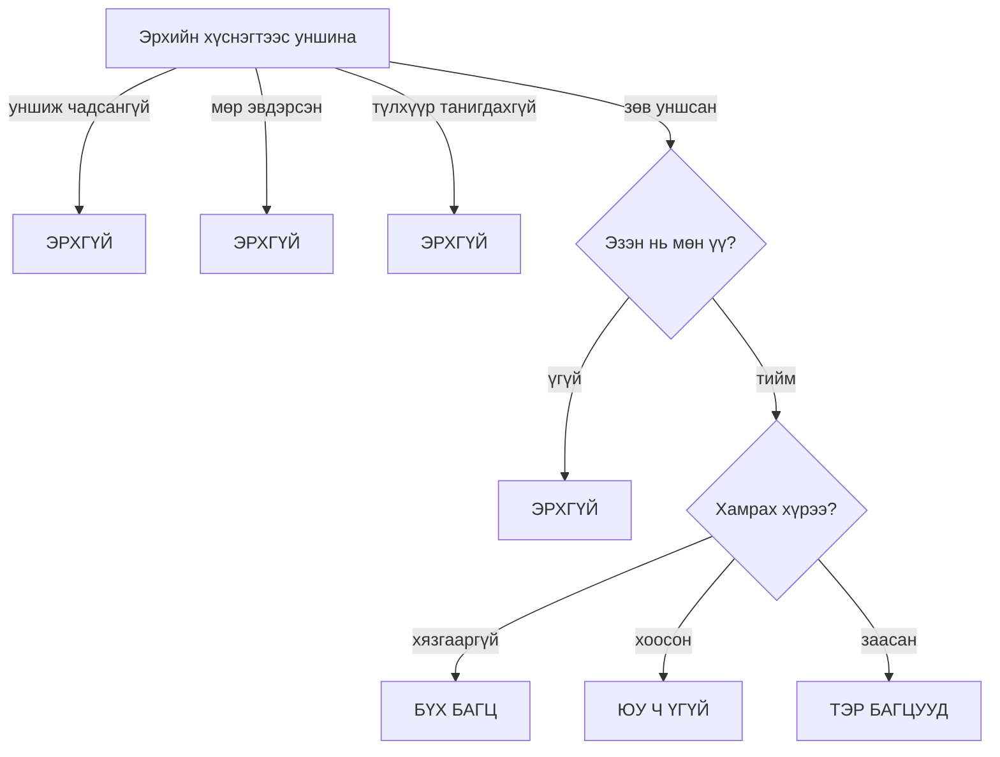
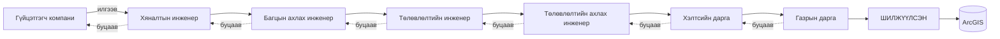

# 05 · Эрх, батлах урсгал, бичилт

Хэн юуг харах, хэн юуг засах вэ? Өгөгдөл ArcGIS руу хэрхэн буцаж бичигддэг вэ?

---

## 1. Эрх ГАНЦ хүснэгтэд

Порталын бүх эрх **нэг ArcGIS хүснэгтэд** хадгалагдана. Шинэ төрлийн эрх
нэмэхэд шинэ багана, шинэ хүснэгт үүсгэдэггүй — мөрийн угтвараар ялгана.

| Угтвар | Юуг заана |
|---|---|
| `__flow__:` | Гүйцэтгэлийн урсгалын шатны томилгоо |
| `__cap__:` | Засах эрх (мөр нэмэх, чанар, зөвшөөрөл, санхүү засах …) |
| `__qaqc__:` | Чанарын багцын хуваарилалт |
| `__huvaari__:` | Хуваарийн багцын хуваарилалт |
| `__obyem__:` | Обьёмын багцын хуваарилалт |
| `__ajil__:` | Нэмэлт ажлын багцын хуваарилалт |
| `__chanar__:` | Чанарын баримтын багцын хуваарилалт (ирүүлэгч · таван хянагч) |
| `__butets__:` | Дэд бүтцийн засварын багцын хуваарилалт |
| `__type__:` | Эрхийн төрлийн загвар (зөвхөн харагдац) |
| `__sys__:` | Системийн төлөв — `__sys__:maintenance` «Систем түр хаах» (хэрэглэгчийн мөр биш, §11) |

⚠️ **Хүснэгтийн эзнийг шалгадаг.** Ижил нэртэй хүснэгт өөр хүн үүсгэж
болно. Систем зөвхөн зөвшөөрөгдсөн эзний хүснэгтийг хүлээж авна — эс бөгөөс
хэн ч ижил нэртэй хүснэгт үүсгээд өөртөө эрх бичиж чадна.

⚠️ **Эдгээр дүрмийг портал хөтөч дээр шалгадаг** — өгөгдлийн жинхэнэ хамгаалалт нь ArcGIS-ийн хуваалцалтын тохиргоо: [08 §8](08-hyzgaarlalt.md).

---

## 2. Эрхгүй гэж үзэх гурван тохиолдол — «хаалттай бол татгалзах»



Систем эргэлзсэн тохиолдолд **үргэлж татгалзана**. Сүлжээ унасан,
тохиргоо эвдэрсэн, эсвэл танихгүй утга тааралдсан — бүгд «эрхгүй».

⚠️ **Яагаад ийм хатуу вэ:** эсрэгээр нь хийвэл сүлжээний түр тасалдал
бүгдэд бүх эрх нээнэ. Хатуу байдал нь заримдаа эвгүй боловч аюулгүй.

---

## 3. Хамрах хүрээ — гурван утга

| Тохиргоо | Утга |
|---|---|
| **Хязгааргүй** | Бүх багц |
| **Хоосон** | ⚠️ **ЮУ Ч БИШ** — «бүгд» ГЭСЭН ҮГ БИШ |
| **Заасан жагсаалт** | Зөвхөн тэр багцууд |

> ⚠️ Хамгийн түгээмэл буруу ойлголт нь **хоосон** тохиргоо. Хэрэглэгчид эрх
> олгоод багц сонгохоо мартвал тэр хүн **юу ч харахгүй**. «Эрх өгсөн атал
> ажиллахгүй байна» гэсэн гомдлын ихэнх шалтгаан энэ.

---

## 4. Гурван хяналт НЭГ кодоос

Хуваарь · Обьём · Чанар гурав нь **яг ижил бүтэцтэй** — ялгаа нь зөвхөн нэр.
Тиймээс тэдгээр нь нэг кодоос ажилладаг.

⚠️ **Яагаад чухал вэ:** урьд нь гурвуулаа тусдаа хуулбар байсан. Шалгалтаар
олдсон 13 алдааны **7 нь** нэг л хэв шинжтэй байв — засвар нь хуулбаруудын
**нэгд нь л** хүрч, бусад руу хуулагдаагүй. Одоо нэг газар зассан нь
гурвуулаад хүчинтэй.

⚠️ Гүйцэтгэлийн урсгал (§5) нь **энд ОРОХГҮЙ** — тэр нь шаттай бөгөөд
«нэг хүн нэг шатанд» гэсэн үндсэн өөр дүрэмтэй.

---

## 5. Гүйцэтгэлийн долоон шатат урсгал



⚠️ **2026-10-23: «Төлөвлөлтийн инженер» шат нэмэгдэв** (багцын ахлах инженерийн
дараа, төлөвлөлтийн ахлах инженерийн өмнө). Төлөвлөлтийн ахлах инженер буцаавал
одоо **төлөвлөлтийн инженерт** очно. Түүний 5 талбарыг (`tolovloltiin_injener*`)
үйлчилгээнд нэмээгүй бол тэр шатны товч хаалттай, дутууг ил хэлнэ. Хадгалагдсан
бусад төлөвийн утга өөрчлөгдөөгүй.

Шат бүр **зөвшөөрөх** эсвэл **буцаах** шийдвэр гаргана. Буцаасан бол
**нэг шат ухарч** өмнөх шатанд шалтгаантайгаа хамт эргэнэ (инженерийн
буцаалт л гүйцэтгэгч рүү очно).

⚠️ **Нэг аккаунт нэг шатанд.** Нэг хүн хоёр шатанд томилогдвол өөрийнхөө
шийдвэрийг өөрөө баталгаажуулах болно — систем үүнийг зөвшөөрөхгүй.

⚠️ **Нэг илгээлтийг нэг хүн зөвхөн НЭГ шатанд батална (2026-10-19).** Систем
шийдвэр бүрийн өмнө тухайн тойргийн шийдвэрийн логийг шалгана
([`hyanaltStore.ts`](../../src/lib/hyanaltStore.ts) → `selfApprovalDeny`):

- Илгээлтийг **илгээсэн** данс аль ч шатанд батлахгүй (урьд нь зөвхөн инженер шатанд).
- **Өөр шатанд** аль хэдийн зөвшөөрсөн данс дахин батлахгүй — шат шилжүүлсэн
  ч (инженерээр баталсны дараа төлөвлөлтийн ахлах инженер болсон). Урьд нь зөвхөн өмнөх
  шатыг шалгадаг байв. Ижил шатыг дахин батлах (дээд шат буцаасны дараа) хэвийн.
- **Админ (super — 2026-10-21-ээс эрхийн хүснэгтийн `role:'super'` мөр) энэ дүрмээс ЧӨЛӨӨТЭЙ — туршихын тулд (2026-10-19,
  хэрэглэгчийн шийдвэр).** Админ шатаа сонгож, нэг дансаар компани болж
  илгээгээд долоон шатыг дараалан туршиж болно (томилгоо · багцын хүрээ ·
  өөрийгөө батлах дүрэм түүнд үйлчлэхгүй). Бусад урсгалд (хуваарь · обьём ·
  нэмэлт ажил · чанар) админ ч өөрийн ажлыг батлахгүй хэвээр.
- Илгээгчдийн жагсаалт уншигдахгүй бол энгийн хэрэглэгчийн шийдвэр **хаалттай** (fail-closed).

⚠️ **Шатны цорын ганц эх сурвалж нь ТОМИЛГОО.** Хэрэглэгчийн шат нь
түүний үүрэг биш, тухайн багцад томилогдсон эсэхээс тодорхойлогдоно.

### 5.1 Хяналтад явж буй хуудсыг дахин бөглөхгүй (2026-10-09)

Илгээлт явуулсны дараа **тэр хуудсыг** (багц × хуудас) бүх 7 шат дуустал
(`Шилжүүлсэн` — газрын дарга батлаж архивлатал) дахин бөглөж, илгээх
боломжгүй. Хянагчийн гар дээр (`OWNER` ≠ company) байгаа АЛЬ Ч өдрийн илгээлт
хуудсыг түгжинэ — шинэ илгээлт ч, тэр илгээлтийг доор нь солих ч хаалттай.
(2026-09-07-ны «хэдэн ч удаа илгээж болно» шийдвэрийг хэрэглэгч өөрчилсөн.)

- **Буцаагдсан илгээлт хориг БИШ.** Гүйцэтгэгчийн гар дээр буцаж ирсэн
  илгээлтийг засаж дахин илгээнэ — өөр өдрийн илгээлт хянагдаж байсан ч
  (`reviewLockBlocks`). Харин тэр өдөр өөрөө хянагчийн гар дээр байвал хаалттай.
- **Хянагчийн харж буй ОДООГИЙН тойргоор.** Ажил бүрийн зөвхөн одоогийн
  тойрог тооцогдоно — хянагчийн дараалалтай ЯГ ИЖИЛ `groupWorks`
  (`hyanaltGroup.ts`) бүлэглэлт. Хуучин тойргийн мөр, хянагчид харагддаггүй
  хуучирсан мөр хуудсыг түгждэггүй.
- **Хуудсаар.** Өөр хуудсын нэртэй мөр алгасагдана; хуудсын нэргүй хуучин мөр
  багцын бүх хуудсанд хамаарна.
- **UI ба домэйн НЭГ дүрэм** ([`hyanaltSubmit.ts`](../../src/lib/hyanaltSubmit.ts)
  → `reviewLockState`): дэлгэц (`useFlow` → `FillNew.reviewLock`, бөглөх эрх
  хаагдаж шалтгаан харагдана) ба домэйн (`reviewLockDeny` →
  [`submission.ts`](../../src/lib/submission.ts) `saveSubmission`, бичихээс ӨМНӨ)
  хоёулаа энэ функцээс уншиж, нэг мессеж (`reviewLockMsg`) харуулна.
- **Fail-closed.** Хяналтын хүснэгт уншигдахгүй бол илгээхгүй. Газрын даргын
  архивын дараах үлдэгдлийн (`residual`) шинэ тойрог хоригт хамаарахгүй.

### 5.2 Батлагчийн харах горим

Хянагчийн шатанд томилогдсон БҮХ батлагч (эсвэл шат сонгосон админ)
Гүйцэтгэл хуудсанд хоёр табтай ([`Guitsetgel.tsx`](../../src/modules/Guitsetgel.tsx)
→ `reviewerView`):

- **«Гүйцэтгэлийн хүснэгт»** — бөглөх хүснэгтийг ЗӨВХӨН ХАРНА (өөрийн
  хариуцсан багцууд). Бичих эрх нь company шатны томилгоо (`FillNew.canPerf`)
  дээр хэвээр тул нүд засаж, илгээж чадахгүй; шалтгаан нь «Батлагчийн
  харагдац» гэж харагдана (`FillNew.reviewerOnly`).
- **«Батлах ажил»** — өөрийн шатны хяналтын жагсаалт (тоотой). Анхдагч таб
  нь энэ — батлах урсгал хөндөгдөхгүй.

### 5.3 Буцаагдсан илгээлт — зөвшөөрсөн нүд түгжээтэй

Буцаагдсан илгээлтэд хянагчийн **ЗӨВШӨӨРСӨН** (ногоон ✓) нүд гүйцэтгэгчид
түгжээтэй — зөвхөн улаан хүрээтэй нүдийг засна (`RO.okLocked`). Нүд нээгдэхгүй,
хайрцаггүй харагдана, буулгалт шалтгаантай татгалзана, Enter/Tab алгасна,
commit давхар хамгаалалттай (`useCellEdit.okLock`). Хянагчийн харагдац хэвээр.

### 5.4 «Зөвхөн харна» (`viewOnly`) томилгоо

Шатны томилгоонд «зөвхөн харна» тэмдэгтэй бол:

- **Хянагчийн шатанд** — шийдвэр (зөвшөөрөх/буцаах) гаргахгүй
  (`hyanaltStore.authz`), дарааллын тоо 0.
- **Гүйцэтгэгчийн (company) шатанд** — бөглөх таб нуугдаж тайлбар харагдана
  (`Guitsetgel.companyViewOnly`), илгээлтийг домэйн ч татгалзана
  (`submission.ts` → `companyDeny`). «Мөр нэмэх» (`addRow`) эрх тусдаа олголт
  тул хэвээр — мөр нэмэх нь «Хуваарь» хуудсанд (§8).

### 5.5 Инженерийн обьём — урсгалын томилгоогүй ч (2026-10-19)

Обьёмын засварлагч/батлагч (`obyemEdit`/`obyemApprove` + багц) урсгалын
шатанд томилогдоогүй байсан ч Гүйцэтгэл хуудасны **«Гүйцэтгэлийн хүснэгт»**
табыг авч, **өөрийн обьёмын багцуудыг** сонгоно
([`Guitsetgel.tsx`](../../src/modules/Guitsetgel.tsx) → `obyemRole`,
[`FillNew.tsx`](../../src/modules/sheet/FillNew.tsx) → `myBagts`). Тэр
багцад зөвхөн обьёмын багана засагдана/батлагдана; гүйцэтгэлийн нүд
гүйцэтгэгч компанийн томилгоогоор хэвээр хаалттай.

---

## 6. Батлах хоёр шат — Хуваарь ба Обьём

Хуваарь, обьёмын өөрчлөлт нь шууд хүчин төгөлдөр болохгүй:

```
Зохиогч → илгээнэ → «хүлээгдэж буй» мөр үүснэ
Батлагч → шийднэ  → зөвшөөрвөл хүчин төгөлдөр
```

> ⚠️ **Зохиогч өөрийнхөө ажлыг батлаж ЧАДАХГҮЙ.** Систем илгээгч ба батлагч
> нэг хүн эсэхийг **хоёр удаа** шалгана: илгээхийн өмнө, мөн бичихийн өмнө
> сервер дээрх бодит утгаар. Тиймээс нэг хүнд «засах» ба «батлах» эрхийг
> хамт өгвөл тэр хүн юу ч батлаж чадахгүй болно.

Хүлээгдэж буй мөр нь өөрчлөлтийн бүрэн агуулгыг хадгална — батлагч
юу өөрчлөгдөхийг **бүтнээр** харж байж шийднэ.

### 6.1 Хуваарийн батлалтын нарийн дүрэм (2026-10-08)

- **Түгжээ ТӨРЛӨӨР.** Хуваарийн илгээлт хоёр төрөлтэй — **гэрээний** огноо ба
  **төлөвлөгөөний** огноо. Хүлээгдэж буй илгээлт зөвхөн ӨӨРИЙН төрлийн табыг
  түгжинэ: гэрээний санал хүлээж байхад төлөвлөгөө табыг засаж, илгээж болно
  (мөн эсрэгээр). Давхардлын шалгалт ч (багц · төрөл)-өөр
  (`huvaariBatlah.loadPending(pkg, kind)`).
- **Хагас бичилтийн тэмдэг.** Батлагч эх хуудсанд бичихээс ӨМНӨ илгээлтийн
  мөрөнд «хагас бичигдсэн» тэмдэг тавина (`markPlanPartial` — төлөв ба
  түгжээг бичихийн өмнө ба дараа дахин уншиж баталгаажуулна). Тэмдэгтэй үед
  зохиогч **татах**, батлагч жирийн **буцаах** хаалттай — эх хуудсанд хагас
  суусан огноо «буцаагдсан» санал болон үлдэхээс сэргийлнэ. Тэмдэг ЗӨВХӨН
  сервер **тодорхой татгалзсан** (нэг ч мөр бичигдээгүй) үед арилна; хариу
  алдагдсан (timeout, сүлжээ) бол эхний багц суусан байж болох тул **үлдэнэ**.
  Батлах амжилттай болоход тэмдэг арилна.
- **«Гацсаныг буцаах»** (`returnStuckPlan`). Тэмдэгтэй илгээлтийг батлагч
  гүйцээж чадахгүй бол (агшин солигдсон, мөр алга, эрх хасагдсан) шалтгаантай
  буцаана — мөр «буцаагдсан» болж, шалтгаан нь «хуудсанд бичигдсэн огноо хэвээр»
  гэсэн угтвартай тул зохиогч юу орсныг мэдэж засна. Эх хуудсанд юу ч бичихгүй.
  Өөр батлагчийн хүчинтэй түгжээтэй бол хаалттай; тэмдэггүй илгээлтэд энэ зам
  хаалттай (жирийн «Буцаах»).
- **Зохиогчид ил.** Цэсний «Хуваарь» тэмдэг нь **«буцаагдсан N»** — зохиогчид
  буцаагдсан илгээлтийн тоо (бусад харагдацын «N хүлээгдэж байна»-аас ялгаатай).
  Зохиогч өөрийн илгээлтийг хэн түгжиж байгаа, хагас бичигдсэн эсэхийг харна.
- **Хяналтад «Өөрчлөлт N» самбар.** Батлагч суурьтай зөрсөн мөрүүдийг (өөрчлөгдсөн
  блокийн чиптэй) жагсаалтаар харж, мөр бүр рүү үсэрч, бүлгээр ✓ тэмдэглэнэ.

---

## 7. Бичилт — өгөгдөл ArcGIS руу буцах

Порталаас ArcGIS руу бичдэг **18** зам бий. Тус бүр нь бичилт амжилттай
болсныг баталгаажуулж, дараа нь холбогдох дэлгэцүүдэд «шинэчил» гэж
мэдэгдэнэ ([03 §3.2](03-ogogdliin-zam.md)).

### 7.1 ⚠️ Хагас нийтлэлийн эрсдэл

Бөглөх хуудас нийтлэхэд мөрүүд **500-гийн багцаар** илгээгдэнэ.

> **Буцаах хамгаалалт нь зөвхөн НЭГ багцын дотор ажиллана.**
>
> 3,000 мөр нийтлэхэд 4 дэх багц дээр сүлжээ тасарвал:
> - Систем «амжилтгүй» гэж хэлнэ
> - Гэвч эхний **1,500 мөр ArcGIS-д аль хэдийн бичигдсэн** байна
>
> Энэ тохиолдолд өгөгдлийг **гараар шалгах** шаардлагатай. Систем үүнийг
> нуухгүй — нийтлэлийн үр дүнд хэдэн мөр бичигдсэнийг ил харуулна.

⚠️ Энэ бол ArcGIS-ийн үйлчилгээний хязгаарлалт, порталын алдаа биш.
Хамгийн найдвартай арга: **бага багаар, олон удаа** нийтлэх.

### 7.2 Бичилт амжилтгүй болбол

Кэш **хөдөлгөөнгүй** үлдэнэ — дэлгэц дээрх тоо хуучин хэвээр. Энэ нь
санаатай: амжилтгүй бичилтийн дараа дахин татах нь сайн өгөгдлийг
дэмий солино.

---

## 8. Хэн юуг бичиж чадах вэ

| Юу | Хаанаас | Ямар эрх шаардлагатай |
|---|---|---|
| Гүйцэтгэл бөглөх | Гүйцэтгэл | Гүйцэтгэгч компанийн шатанд багцад томилогдсон («зөвхөн харна» биш), хуудас хяналтад явж байхгүй (§5.1) |
| Гүйцэтгэл батлах | Гүйцэтгэл | Шатны томилгоо — 7 шат: гүйцэтгэгч компани (илгээнэ) · хяналтын инженер · багцын ахлах инженер · төлөвлөлтийн инженер · төлөвлөлтийн ахлах инженер · хэлтсийн дарга · газрын дарга |
| Хуваарь засах | Хуваарь | Хуваарийн зохиогчийн багц (хүрээ) |
| Хуваарь батлах | Хуваарь | Хуваарийн батлагчийн багц (засах эрхээс **тусдаа**) |
| Обьём засах / батлах | Гүйцэтгэл | Обьёмын эрх + багц, батлах нь тусдаа (урсгалын томилгоо шаардахгүй — §5.5) |
| Чанарын баримт | Чанар | Чанарын эрх + багц |
| Зөвшөөрөл | Зөвшөөрөл | Зөвшөөрлийн эрх |
| Газрын талбарын төлөв | Газар чөлөөлөлт | Газрын эрх |
| Дэд бүтцийн атрибут | Инженерийн дэд бүтэц | Дэд бүтцийн эрх |
| Мөнгөн урсгалын төлөвлөгөө | Санхүүжилт | Санхүү засах эрх |
| ХАБЭА-ийн бүртгэл (зааварчилгаа · мэдэгдэх · сануулах хуудас · хог хаягдал), үзлэгийн тайлан татах | ХАБЭА | `habeaData` — батлагчгүй, багцаар хуваарилагдахгүй |
| Системийг түр хаах / нээх (§11) | Цэсний «Систем» → «Систем түр хаах» | `sysClose` (аккаунтаар) эсвэл super (эрхийн хүснэгт) |
| Мөр нэмэх (нэмэлт ажил илгээх) | Хуваарь | Нэмэлт ажлын «Мөр нэмэгч» + багц — ⚠️ бүтэц өөрчилдөг тул эрсдэлтэй |
| Нэмэлт ажил батлах | Нэмэлт ажил батлах | Нэмэлт ажлын «Батлагч» + багц (мөр нэмэгчээс **тусдаа**) |
| MA-гийн хавсралт нэмэх/устгах | Материал баталгаажуулалт | Чанарын баримтын ирүүлэгч эсвэл хянагч — **тухайн MA-гийн багцад** (2026-10-19) |

⚠️ «Мөр нэмэх» нь хуудасны бүтцийг өөрчилдөг тул **бүх жин, мөнгөн дүн
дахин бодогдоно**. Тиймээс энэ нь үүрэгт автоматаар дагалддаггүй, нэг
бүрчлэн олгогддог. 2026-10-19-нөөс мөр нэмэгчид **«Хуваарь»** хуудас
нээгдэнэ (урьд нь «Гүйцэтгэл» нээгддэг ч мөр нэмэх товч тэнд байгаагүй);
сонгогчид хуваарийн багцууд ба мөр нэмэх багцууд нэгдэж харагдана —
огноо засах нь хуваарийн хүрээгээр, мөр нэмэх нь нэмэлт ажлын хүрээгээр.

⚠️ **Хуваарилалттай урсгалд эрх = ХҮРЭЭ (2026-10-19).** Хуваарь (зохиогч ·
батлагч) ба нэмэлт ажил, обьём, чанарын баримтын засах эрх нь багцын
хуваарилалтын **тусгал** (хуваарилахад автоматаар олгогдоно). Хуваарийн
засах/батлах үйлдэл, цэсний тэмдэг, «Улсын комисс»-ын мөр нэмэлт бүгд ЗӨВХӨН
багцын хүрээгээр шалгана — эрх (`plan`/`planApprove`) тусад нь шаардахгүй,
эс бөгөөс эрхийн бичилт унасан хүнд товч идэвхтэй атлаа тэмдэг 0 гэх мэт
зөрчил гардаг байв.

⚠️ **Өөрийгөө батлах шалгуурын «хэн».** FIC · М-актын «өөрийн оруулсныг
батлахгүй» шалгуур нь порталын нэвтрэх нэрээр (2026-10-20-оос Сэлбэ Enterprise
геопортал — AGOL хасагдсан) — эрх, багцын хүрээтэй ижил таних тэмдэг. Тусдаа
Enterprise нэвтрэлтийн цонх (`EntSignIn`) нь зөвхөн PDF, хүснэгт рүү бичих
тээвэр — таних тэмдэг биш.

---

## 9. Админ портал — харах ба засах эрх ТУСДАА

Админ портал (зөвхөн super) хажуугийн цэстэй. **Харах** ба **засах** эрх
хоёр өөр газраас олгогдоно:

| Цэс | Юу тохируулна | Хадгалалт |
|---|---|---|
| Тойм | Багц × системийн матриц, хүн бүрийн эрх, гацааны анхааруулга, **эрхийн хүснэгтийн цэвэрлэгээ** (эвдэрсэн мөр · танигдаагүй багц) | шууд |
| Хэрэглэгчдийн эрх удирдах | **Зөвхөн харах**: аккаунт · үүргийн шошго · 19 харах хуудас · ТЭЗҮ-БОНУ | ноорог → «Хадгалах» |
| Эрхийн төрөл | Төрөл бүрийн харагдац · ТЭЗҮ-БОНУ · нүүр цонх (засах эрх ОРОХГҮЙ; «админ самбар» мөр идэвхгүй — админ самбар зөвхөн Super төрөлд, загвараас тохируулагдахгүй) | шууд |
| Гүйцэтгэлийн урсгалын эрх | Долоон шат × багц | шууд |
| Засах эрх — 12 хуудас | Урсгал бүр өөрийн хуудастай (доор) | шууд |

Засах эрхийн 12 хуудас (**нэг урсгал = нэг хуудас** — зохиогч ба батлагч
нэг хуудсанд). Багцаар олгодог хуудсууд ба «Гүйцэтгэлийн урсгалын эрх» нь
**«багц × үүрэг» хүснэгт** (мөр = багц, багана = үүрэг/шат): нүд бүрд тэр
багцын тэр үүргийн аккаунтууд, «+»-ээр нэмж ✕-ээр хасна. «Бүх багц»-тай
аккаунт мөр бүрд бүдэг харагдана; нэг мөрөөс хасвал бусад багцын ил жагсаалт
болно (асууна). Гацах нүд (батлагч/хянагчгүй, зохиогч өөрөө л батлагч) бүдэг
шар, мөрийн толгойд ⚠. Хадгалалт аккаунтаар хэвээр:

| Хуудас | Үүрэг | Хэрхэн олгоно |
|---|---|---|
| Хуваарийн эрх | Зохиогч · Батлагч | багцаар |
| Нэмэлт ажлын эрх | Мөр нэмэгч · Батлагч | багцаар |
| Инженерийн обьёмын эрх | Засварлагч · Батлагч | багцаар |
| Чанарын баримтын эрх | Ирүүлэгч · ТУХ · Чанар · ХАБЭА · ТУГ · ЧХ инженер | багцаар |
| Чанарын (QAQC) эрх | ITP бөглөгч | багцаар |
| Инженерийн дэд бүтцийн засварын эрх | Засварлагч | багцаар |
| Зөвшөөрөл засах | — | аккаунтаар |
| Санхүүгийн бүртгэлийн эрх | «утга засах» ба «мөр нэмэх, устгах» — хоёр хэсэг | аккаунтаар |
| Газрын төлөв засах | — | аккаунтаар |
| Багцын хамаарал засах (`hamaaral`) | — (батлагчгүй) | аккаунтаар |
| ХАБЭА-ийн бүртгэл оруулах (`habeaData`) | — (батлагчгүй) | аккаунтаар |
| Систем түр хаах (`sysClose`, §11) | — (батлагчгүй, харагдац нээхгүй) | аккаунтаар |

⚠️ **Урсгалтай 7 хуудас хэрэглэгчийн картын «Харагдац» жагсаалтад ОРОХГҮЙ:**
Гүйцэтгэл · Хуваарь · Хуваарь батлах · Нэмэлт ажил батлах · Чанарын баримт ·
Чанар (QAQC) · Материал баталгаажуулалт (`ma`). Тэдгээр нь урсгалын хуваарилалт олгоход автоматаар нээгдэж,
хасахад хаагдана (`CAP_HOST_VIEW`, урсгалын шат). «Бүгдийг асаах/унтраах» ба
«Эрхийн төрөл» загвар тэдгээрийг хөндөхгүй. Бусад засах эрхийн харагдац
(зөвшөөрөл · санхүү · газар · дэд бүтэц) картад бүдэг унтраалгаар харагдана —
хаах бол тухайн эрхийн хуудсанд эрхийг нь хасна.

⚠️ **Багцаар олгогддог эрх шууд унтраалгаар олгогдохгүй** — эрх нь
хуваарилалтын тусгал. Хуваарилалтгүй атлаа асаалттай (өнчин) эрх тухайн
хуудсанд улаанаар харагдаж, ил «хасах»-аар л арилна. Super-т
хуваарилалт үйлчилдэггүй — түүнд **бүх эрх автоматаар** (2026-10-12-оос), эрхийн
хуудсанд тусад нь тохируулахгүй, жагсаалтад ч орохгүй.

⚠️ «Төрлөөр тохируулах» нь **зөвхөн харагдац** солино — засах эрхийг
хөндөхгүй (2026-09-30-ны шийдвэр).

⚠️ **Админ (super) = ЭРХИЙН ХҮСНЭГТИЙН мөр (2026-10-21, хэрэглэгчийн шийдвэр:
«тохиргооноос давсан хатуу эрх байж болохгүй»).** Кодын хатуу super хасагдсан
(`ROLE_BY_USER` production-д хоосон, зөвхөн тестэд). `role: super` мөртэй
(устгагдаагүй) аккаунт бүр super: бүх харагдац · бүх засах эрх · админ портал ·
Гүйцэтгэлийн «Нэгтгэл» таб ба нийтлэл · систем хаалттай үед нэвтрэх. Дүрэм:
- Super-ийг зөвхөн **super админ** олгоно/хасна (хэрэглэгчийн карт — «Super»
  төрөл · үүргийн сонгогч · «Устгах»); өөрийн super-ийг **өөрөө хасахгүй** —
  өөр super хасна (сүүлчийн админ түгжигдэхээс сэргийлнэ).
- Хүснэгт уншигдаагүй сешнд хэн ч super биш (fail-closed; localStorage-д
  өөртөө `super` бичих зам хаалттай); уншигдсаны дараа 5 минутын poll-оор
  бусад админы өөрчлөлт хүрнэ.
- Хүснэгтэд super **огт байхгүй** бол анхны админ (`roles.BOOTSTRAP_SUPER` =
  `tumenjargal_selbe`) super — самбарт орж super олгоно; super мөр бий болмогц
  энэ нь үйлчлэхгүй. Анхны админ өөр хүнд super олгохдоо **өөрийн `super`
  мөрөө эхэлж бичнэ** (`permissions.setUser`, 2026-10-21) — эс бөгөөс тэр
  агшинд өөрөө super-ээ алдаж, мөргүй тул дараагийн нэвтрэлтэд түгжигдэх байв;
  өөрийн мөр бичигдээгүй бол нөгөөд олгохгүй. Идэвхтэй анхны админ самбарт
  (`listUsers`) синтетик super мөрөөр харагдана.
- Хүснэгтийн super-ийн **хуваарилалт энгийн мөр** (2026-10-21): ✕ нэг багцыг л
  хасна, сүүлийнх асууж эрх буцаана, `__cap__:` эрх нь синклэгдэнэ — доошлуулсны
  дараа хуваарилалт хэвээр. Зөвхөн кодын (тестийн) super-ийн мөр «цэвэрлэх мөр»
  (`aclOps.isCleanup`). Super байхад хүрээ нь хязгааргүй хэвээр.
- ⚠️ Enterprise дээр `SYS_Selbe_Permissions` org-даяар **засагдах** бол
  (Editing + org sharing) засах эрхтэй аккаунт бүр өөртөө `super` мөр бичиж чадна
  — админ самбар улаанаар хэлнэ (`permsRemote.permsTableOrgEditable`); засвар нь
  серверийн тохиргоо: засах эрхийг админ бүлгээр хязгаарлах (уншилт org-д хэвээр).
Урьд (2026-10-15 … 10-20) super зөвхөн кодоор, панелийн `role: super` мөр
энгийн хэрэглэгч байв. Кодонд жишээ урсгалын аккаунт (`selbe_guitsetgegch`
г.м.) **байхгүй** — урсгалын хүнийг панелаас нэмж, «Гүйцэтгэлийн урсгалын
эрх»-д шатанд томилно.

⚠️ **Шатанд томилох/шилжүүлэх нь хувийн тохиргоог дарахгүй (2026-10-19).**
Шатны загвар харагдац одоо байгаа харагдац дээр **нэмэгдэнэ** (солигдохгүй);
ТЭЗҮ-БОНУ-гийн сонголт хэвээр (зөвхөн шинэ хүнд загвараас); админы ил
сонгосон урсгалын бус эрхийн төрөл солигдохгүй.

⚠️ **Эрхийн хүснэгтийн цэвэрлэгээ (Тойм, 2026-10-19).** Задлагдахгүй
(эвдэрсэн JSON, шатгүй урсгалын мөр, нэргүй мөр) мөр эрх ОЛГОХГҮЙ (хаалттай)
боловч чимээгүй алгасагдахаа больж Тоймд нэрээрээ жагсана. Багцын нэр нь
одоогийн багцын жагсаалтад алга (нэр солигдсон) хуваарилалт «танигдаагүй
багц» гэж Тойм ба хэрэглэгчийн картад харагдана. Угтвар (`__flow__:` г.м.)
том/жижиг үсэг ялгахгүй, нэрийн зай/үсгийн хэлбэр уншихад ч бичихэд ч нэг
түлхүүр болно. Бүх долоон шат хоосон багц «урсгал томилогдоогүй» гэж шар
анхааруулгатай; гацаа гарсан ч админ (super) шийдвэрлэх боломжтой бол
текстэд ил бичигдэнэ (анхааруулга арилахгүй).

---

## 10. Зэрэг ажиллах — түгжээ, гацалт, зөрчил (2026-10-09)

ArcGIS-д **нөхцөлт update байхгүй**. Тиймээс хоёр хүн нэг мөрд зэрэг бичихэд
«сүүлд бичсэн нь ялна» — доорх замууд үүнийг ил болгож, хаана боломжтой бол
түгжинэ. Завсар маш богино, гэхдээ тэг биш.

### 10.1 Нэмэлт ажлын батлалт — `casAjilClaim`

Батлагч шийдвэр гаргахын өмнө `pending` мөрийг **атомаар түгжинэ** (CAS):
(1) дахин уншина — төлөв зөв, өөр хүний/табын хүчинтэй түгжээгүй; (2) тэмдгээ
бичнэ; (3) дахин уншиж ЯГ өөрийн тэмдэг үлдсэнийг батална — зэрэг бичсэн хүн
ялсан бол түүний нэрийг хэлнэ. Түгжээтэй үед өөр батлагчийн шийдвэр, зохиогчийн
татах/засах татгалзана. Шийдвэрийн бичилт тэмдгийг өөрөө арилгана. Буцаалт
(`approved` мөрд) ч мөн түгжээг эхэлж авна. Урьд нь хоёр батлагчийн шийдвэр
чимээгүй бие биеэ дардаг байв.

### 10.2 Обьёмын батлалт — «завгүй» · «хагас бичигдсэн» · «Гацсаныг буцаах»

- Батлагч эхлээд үндсэн өгөгдөлд (`applyUpdates`), дараа нь илгээлтийг
  `approved` болгодог. Завсарт унавал `pending` мөрд **хагас бичигдсэн тэмдэг**
  (`PARTIAL_MARK`) үлдэнэ — хугацаагүй, зөвхөн амжилттай батлахад арилна.
  Тэмдэгтэй үед зохиогчийн татах ба жирийн «Буцаах» хаалттай; «Батлах» (бичилтийг
  гүйцээх) нээлттэй.
- **`obyemBusyFor`**: багцын обьём батлагчийн түгжээтэй эсвэл хагас бичигдсэн
  үед нэмэлт ажил буулгахыг хаана (эс бөгөөс обьём хуучин жаазад бууна).
  Уншилт унавал fail-closed — бичихгүй.
- **«Гацсаныг буцаах»** (`returnStuckObyem`, хуваарийн `returnStuckPlan`-ийн
  загвар): батлагч бичилтийг гүйцээж чадахгүй бол (жааз солигдсон, мөр алга,
  эрх хасагдсан) батлагч эсвэл super шалтгаан бичээд `returned` болгоно.
  Шалтгаан нь угтвартай тул зохиогч үндсэн өгөгдөлд юу орсныг мэдэж засна.
  Үндсэн өгөгдөлд юу ч бичихгүй. Өөр батлагчийн хүчинтэй түгжээтэй бол хаалттай.

### 10.3 Чанар (QAQC) — хадгалахын өмнөх зөрчлийн шалгалт

`saveQaqc` нөхцөлгүй `updates` илгээдэг тул хадгалахын ӨМНӨ хөндөх мөрүүдийг
серверээс **дахин уншина** (`qaqcConflicts`). Нүдний суурь (засах үед харсан
утга)-аас серверт ӨӨРЧЛӨГДСӨН нүдийг бичихгүй — хадгалаагүй засвар хэвээр
үлдэж, нэрлэгдэнэ. Сервер аль хэдийн ижил утгатай бол зөрчил биш. Серверт
устгагдсан мөрийн засварыг хадгалахгүй, булшилж хасна. Талбарын уртаас хэтэрсэн
утгыг таслахгүй — хадгалахын өмнө анхааруулна.

### 10.4 Гүйцэтгэл бөглөх — хоёр хүн нэг багцыг зэрэг

Ноорог нүд бүрээр **LWW** (сүүлд бичсэн нь ялна, `mergeDrafts`) — энэ дүрэм
өөрчлөгдөөгүй; доорх нь зөвхөн юу болсныг ИЛ хэлж, эзэмшлийг зөв тавина
([`draft.ts`](../../src/modules/sheet/fill/draft.ts),
[`useDraftSync.ts`](../../src/modules/sheet/fill/useDraftSync.ts)):

- **Илгээлтийн баримт (receipt).** Нэг хүн илгээхэд «юу илгээгдсэн» баримт
  ноорогт үлдэнэ. Нөгөө табын татах мөчлөг ШИНЭ баримт олбол илгээлтийг дахин
  уншина — илгээгдсэн нүд дахин орж ДАВХАР тоологдохгүй; илгээлтээс өмнөх
  хувилбараас үргэлжилсэн засвар зөрүү болж анхааруулна.
- **Нүдний цаг (HLC).** Шинэ гараар засвар тухайн нүдэнд харсан хамгийн хожуу
  алсын агшнаас ҮРГЭЛЖ хожуу тамгалагдана — өөр хүний буцаалтыг харсны дараа
  бичсэн утга «эрт» гэж хасагдахгүй.
- **Эзэмшил.** Өөр хүн миний нүдийг хожуу дарж бичвэл нүд түүнийх болно
  (тайлбар ба «Илгээх» хүлээлт зөв).
- **Мэдэгдэл.** «{нэр} таны бөглөсөн нүдийг өөрчиллөө» — нүд бүрд нэг удаа,
  нүд богино тодорно. «Илгээх»-ийн өмнө алсыг дахин шалгана.
- **Ноорог сэргэтэл хүснэгт хаалттай.** Хэрэглэгчийн ноорог (хуваалцсан ноорог
  орно) бүрэн сэргэж дуустал бөглөх хүснэгт НУУГДАЖ идэвхгүй (`inert`) байна —
  сэргээгдээгүй өгөгдөл дээр засвар, буулгалт уралдахгүй (`useDraftSync` →
  `restoringUi`). Хүснэгт салгагдахгүй, зөвхөн нуугдана. 45 секундээс удвал
  (`RESTORE_SLOW_MS`) зөвхөн «Хуудас дахин ачаалах» товч гарна — хүснэгт
  өөрөө нээгдэхгүй. Хуваарьт ижил хаалт: [04 «Хуваарь»](04-haragdac.md).
- **Хяналтад явж буй хуудас** нь илгээлт 7 шатаа дуустал дахин бөглөгдөхгүй
  (§5.1); буцаагдсан илгээлтэд зөвшөөрсөн нүд түгжээтэй (§5.3).

---

## 11. Систем түр хаах (2026-10-19)

Систем нийслэлийн дата төв рүү шилжих үед порталыг **бусад бүх хэрэглэгчид**
түр хаана. Хаалттай үед нэвтэрсэн хүн бүтэн дэлгэцийн цонх харна:
**«Систем түр хаагдсан»** — тогтмол текст «Системийг нийслэлийн дата төв рүү
шилжүүлж байгаа тул түр хаагдсан. Түр хүлээнэ үү.», хаагчийн **нэмэлт
тайлбар** ба **«Дахин нээгдэх: …»** (хоёулаа сонголттой), «Дахин шалгах» ба
«Гарах» товч.

| Асуулт | Хариу |
|---|---|
| Хэн хааж/нээж чадах вэ | `sysClose` эрхтэй аккаунт (админ самбарын «Систем түр хаах» хуудаснаас аккаунтаар) ба super (эрхийн хүснэгт) |
| Хаалттай үед хэн нэвтрэх вэ | Мөн тэд — шилжилтийг шалгана. Тэдэнд дээд хэсэгт шар зурвас «Систем бусад хэрэглэгчдэд хаалттай» |
| Хаана удирдах вэ | Порталын зүүн цэсний «Систем» бүлэг → «Систем түр хаах» (төлөв, тайлбар, хугацаа, баталгаажуулах асуулттай) |
| Хаана хадгалагдах вэ | Эрхийн хүснэгтийн `__sys__:maintenance` мөр — `views` JSON `{on, note, until, by, at}` |
| Дотор байгаа хүнд хэзээ гарах вэ | Дараагийн эрхийн шалгалтад (5 мин эсвэл таб идэвхжихэд). Хадгалаагүй ажил устахгүй — портал цонхны ард амьд |
| Нээгдэхийг хэзээ мэдэх вэ | Хаалттай хэрэглэгч 30 секунд тутам шалгана; «Дахин шалгах» шууд |

⚠️ **Төлөв зөвхөн нэвтэрсний ДАРАА уншигдана.** Статик сайт, сервергүй тул
нэвтрэхээс өмнөх нээлтийн хуудсанд хүснэгт уншигдахгүй — цонх ArcGIS-д
нэвтэрмэгц гарна.

⚠️ **Уншилт унавал сүүлийн мэдэгдэж буй төлөв (fail-open).** Энэ нь §2-ын
«эргэлзвэл татгалзах»-аас санаатай эсрэг: хаалт бол бүх хүнийг гаргах үйлдэл
тул ArcGIS-ийн түр саатал эсвэл гараар эвдэрсэн мөр бүх байгууллагыг
түгжих ёсгүй. Хаалт **зөвхөн ил `on: true`**-гээр; эвдэрсэн мөр Тоймын
цэвэрлэгээнд гарна. Хуудсыг дахин ачаалахад төлөв дахин уншигдана (хөтөчид
кэшлэгдэхгүй).

⚠️ **Клиент талын хаалт** (§1-ийн ⚠️): ArcGIS-ийн токен хүчинтэй хэвээр, өгөгдлийн
жинхэнэ хамгаалалт нь ArcGIS-ийн хуваалцалт. Хаалттай үед порталын бичих
функцүүд татгалзана (нэвтэрсэн хэрэглэгчийн нэр хоосорно).

---

**Дараагийн алхам:** [06 · Тоог зөв ойлгох](06-toonii-dursam.md) ·
[08 · Хязгаарлалт](08-hyzgaarlalt.md)

---

**Хамгийн сүүлд шинэчилсэн:** 2026-10-19
**Автомат шалгуур:** байхгүй — эрхийн логикийг `aclParity` болон
`huvaariBatlah` зэрэг кодын шалгуурууд хамгаалдаг
**Гараар шалгах:** бичих замын тоо (18), багцын хэмжээ (500)
